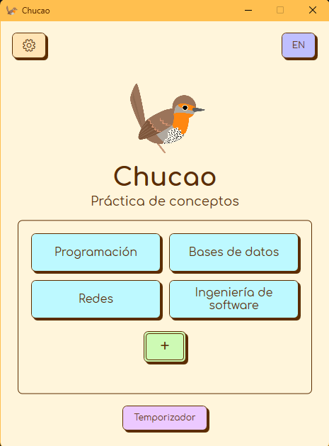
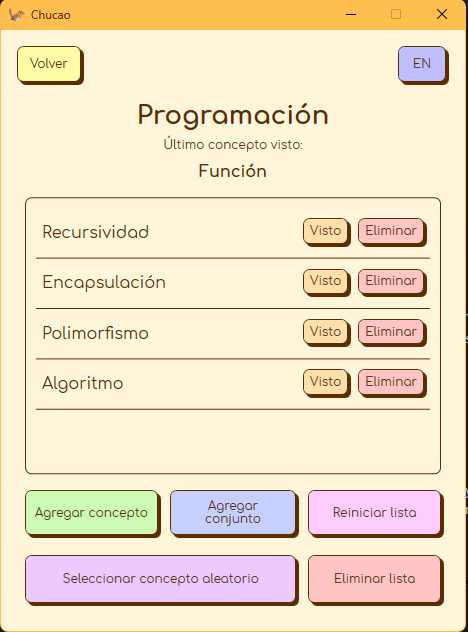
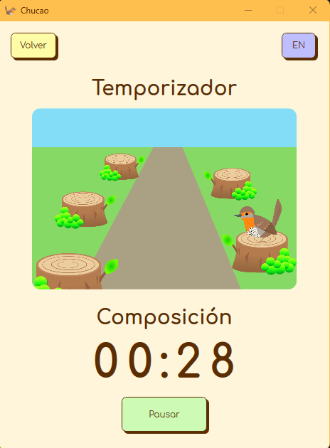
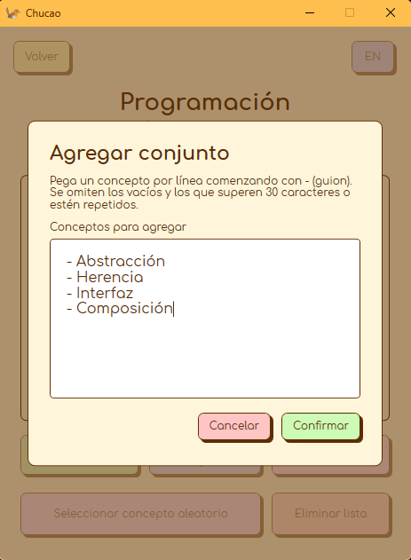
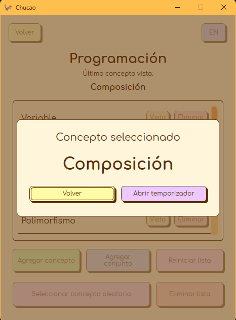
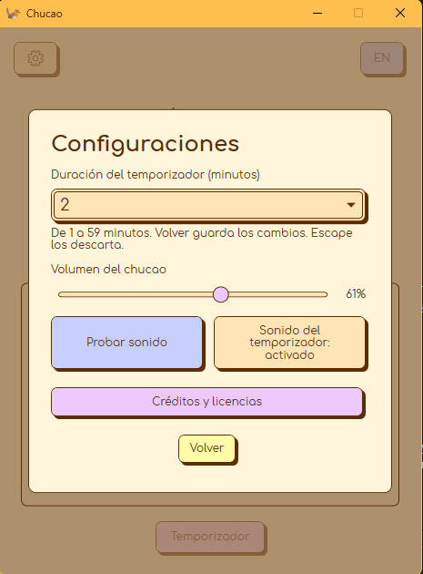

Chucao is a Windows desktop application that turns your concept lists into rounds of speaking practice. Each turn randomly selects a concept without repeating it within the round, and offers a timer to accompany your explanation.

[Download for Windows x64](https://github.com/sebastianolmos/chucao/releases) · [View the source code on GitHub](https://github.com/sebastianolmos/chucao)

### Context, goal, and contribution

I created Chucao to address a specific need. I wanted to practice explaining different sets of concepts aloud without seeing the same concept twice in one round. I also wanted to bring this routine into a simple desktop application.

I built the interface, list management, and random selection with local saving, so each round can be resumed in another session. I added a timer with an animated chucao to accompany the explanation.

### How it works

When you open a list, Chucao reads its CSV file and shows the pending concepts. Each row stores the text and a `SeenOrder` value. Zero means the concept is available; positive values record the order in which concepts appeared. When you select **Select random concept**, the service randomly chooses an index among the pending rows and assigns that concept the next number in the sequence. The highest value lets Chucao recover the last concept seen when you reopen the list.

The order of operations matters. Chucao writes the updated CSV to a temporary file, replaces the list file, and only then shows the concept. If the file is locked and saving fails, a warning appears and the concept stays pending.

From the result, you can open the timer with the concept in view. The countdown uses a monotonic clock to measure elapsed time and prevent interface delays from accumulating. The animation uses that same time to calculate the chucao's position along the route. Pausing stops its movement, and when the counter reaches `00:00`, the bird reaches the final point.

### Technologies

C# and .NET 10, WPF with XAML for the interface, and CsvHelper for reading and writing local CSV files.

### Outcome and how to verify it

A round can span multiple sessions and is reset when the user chooses. To try it, create a list with “Stack,” “Queue,” and “Tree,” draw a concept, and close Chucao. When you reopen the list, the first concept should appear as the last one seen, while only the other two remain available. After drawing those, the button is disabled. Resetting the list makes all three available again.

### Scope

If you leave the timer in the middle of an explanation, the next time you open it, it will be ready with the full configured duration.

### Screenshots

