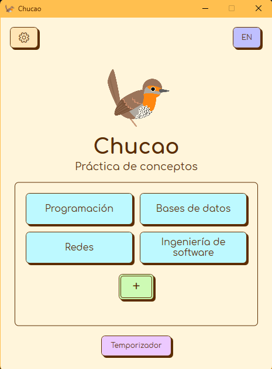
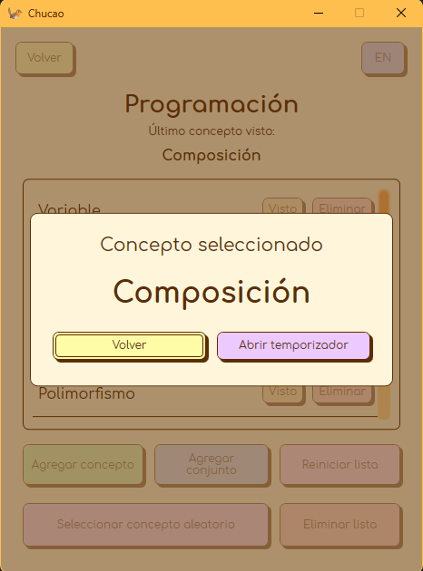

Chucao es una aplicación de escritorio para Windows que convierte tus listas de conceptos en rondas de práctica oral. En cada turno propone un concepto al azar, sin repetirlo dentro de la ronda, y ofrece un temporizador para acompañar la explicación.

[Descargar para Windows x64](https://github.com/sebastianolmos/chucao/releases) · [Ver código fuente en GitHub](https://github.com/sebastianolmos/chucao)

### Contexto, objetivo y aporte

Creé Chucao a partir de una idea concreta. Quería practicar explicaciones en voz alta con distintos conjuntos de conceptos, sin que un concepto volviera a salir en la misma ronda. También quería llevar esa dinámica a una aplicación de escritorio sencilla.

Implementé la interfaz, la gestión de listas y el sorteo con guardado local, que permite retomar cada ronda en otra sesión. Incorporé un temporizador con la animación del chucao para acompañar la explicación.

### Cómo funciona

Al abrir una lista, Chucao lee su archivo CSV y muestra los conceptos pendientes. Cada fila guarda el texto y un valor `SeenOrder`. El cero indica que el concepto está disponible y los valores positivos registran el orden de aparición. Al pulsar **Seleccionar concepto aleatorio**, el servicio elige un índice al azar entre las filas pendientes y asigna al concepto el siguiente número de la secuencia. El mayor valor permite recuperar el último concepto visto al reabrir la lista.

El orden de las operaciones importa. Chucao escribe el CSV actualizado en un archivo temporal, reemplaza el archivo de la lista y solo entonces muestra el concepto. Si el archivo está bloqueado y falla el guardado, aparece un aviso y el concepto sigue pendiente.

Desde el resultado se puede abrir el temporizador con el concepto a la vista. La cuenta usa un reloj monotónico para medir el tiempo transcurrido y evitar que los retrasos de la interfaz se acumulen. La animación usa ese mismo tiempo para calcular la posición del chucao entre puntos del recorrido. Al pausar se detiene su desplazamiento y, cuando el contador llega a `00:00`, el ave alcanza el último punto.

### Tecnologías

C# y .NET 10, WPF con XAML para la interfaz y CsvHelper para la lectura y escritura de archivos CSV locales.

### Resultado y cómo comprobarlo

Una ronda puede repartirse entre varias sesiones y se reinicia por decisión de quien practica. Para comprobarlo, crea una lista con «Pila», «Cola» y «Árbol», sortea un concepto y cierra Chucao. Al volver a abrir la lista, el primer concepto debe aparecer como el último visto y solo deben quedar disponibles los otros dos. Después de sortearlos, el botón se desactiva. Al reiniciar la lista, los tres vuelven a estar disponibles.

### Alcance

Si sales del temporizador a mitad de una explicación, la próxima vez que lo abras estará preparado con la duración completa configurada.

### Capturas

