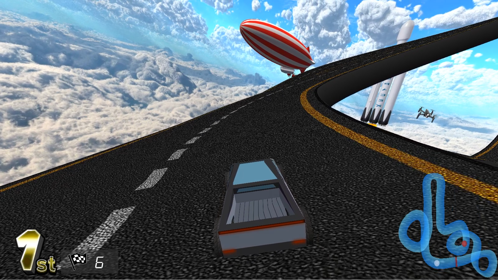
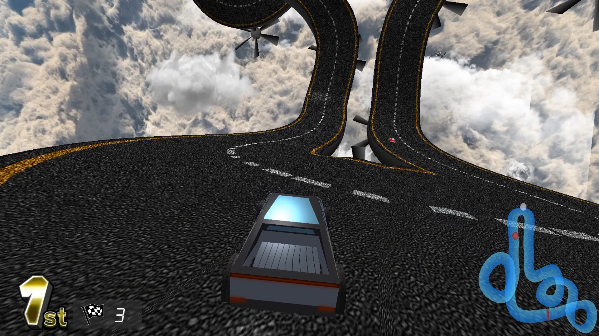
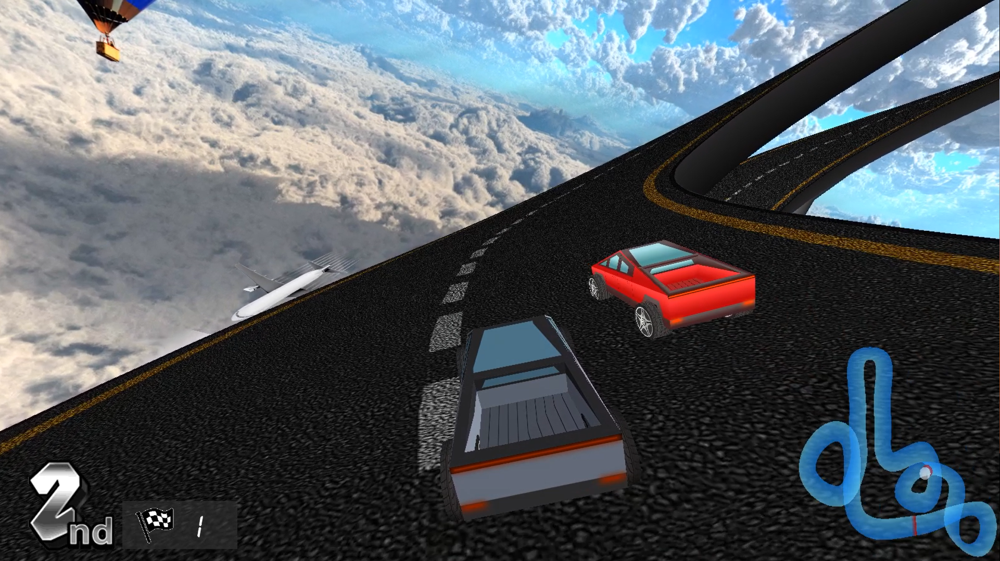
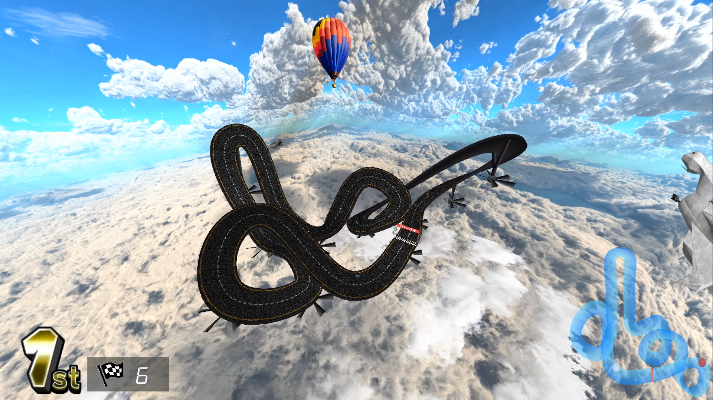

I built a racing prototype where you can drive on a track suspended in the air, with elevation changes and banked turns, while competing against an automated opponent. A single 3D curve defines the circuit and guides the cars along it.

[View the source code on GitHub](https://github.com/sebastianolmos/crazy_racer) · [Watch the sample video](https://youtu.be/5rhhQ2h8ldA)

## Context and personal contribution

I developed Crazy Racer as the second assignment for **CC3501, Modeling and Computer Graphics**, at the University of Chile during the fall 2020 semester. The challenge was to turn a spatial curve into a track with width and thickness, then let a keyboard-controlled vehicle follow its changes in elevation and banking.

I implemented track generation and vehicle movement, then integrated an automated opponent, cameras, and a minimap. For the curve, I applied the *Rounded Nonuniform Spline* method described by Thomas Lowe in chapter 2.4 of *Game Programming Gems 4*. I reused the course's graphics utilities for transforms, scene graphs, and shaders.

## How it works

**From 17 points to a drivable track.** At startup, the program connects 17 control points in 3D using cubic Hermite segments and closes the curve by connecting the last point to the first. Each segment occupies a fraction of the progress parameter proportional to the straight-line distance between its endpoints. When sampling the curve, I calculate the tangent from its derivative and combine it with an interpolated orientation to obtain the cross-track axis. I offset a vertex to each side and connect successive sections with triangles. I adjusted the orientation at some control points to bank selected segments.

**From keyboard input to a position on the track.** The car stores two coordinates: progress `t` around the lap and lateral displacement `s` from the center. At each update, the program proposes a movement based on heading, speed, and elapsed time. Local projections estimate the new coordinates and check the lateral boundary. If the movement stays within the track, the program reconstructs the 3D position from those coordinates. If it crosses the boundary, it keeps the last valid position and sets speed to zero. Local axes let the car follow the track's slope and banking. The opponent uses the same representation and moves with a fixed lateral offset.

## Technologies

Python, NumPy for geometry, OpenGL through PyOpenGL for rendering, GLFW for the window and keyboard input, Pillow for loading textures, and Blender for modeling the car.

## Outcome and how to try it

The result is a closed, drivable circuit. The car follows elevation changes, stops when it tries to leave an edge, and shares the track with an opponent that moves on its own. The minimap shows the positions of both cars.

With the README dependencies installed, run `python crazy-racer.py` from `code/`. Accelerate with **W** and steer with **A** or **D** toward an edge to check that the car stops. Press **V** until you reach the global view to see the full layout and its elevation changes. The minimap lets you track the opponent even when it is outside the camera view.

## Limitation

The progress parameter uses straight-line distances between control points as an approximation of curve length. As a result, even though the opponent increments `t` at a fixed rate, its speed through space can vary along the circuit.

## Screenshots

