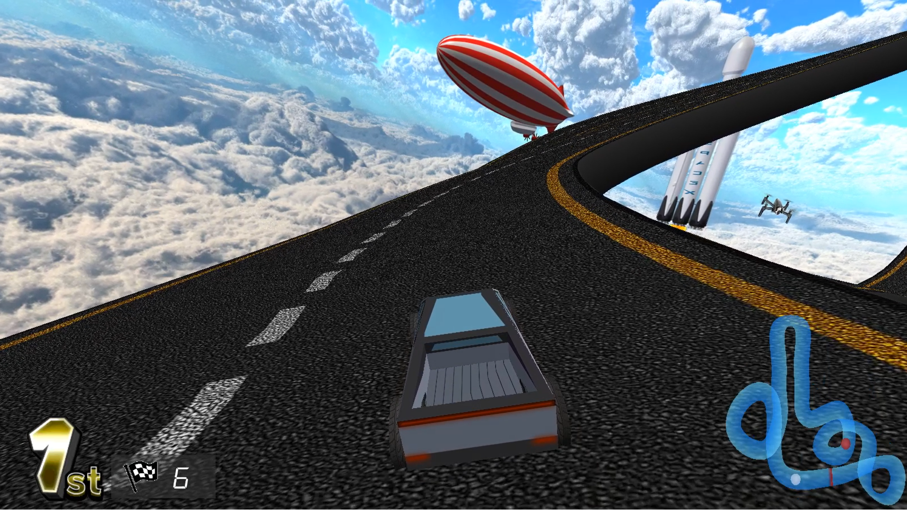
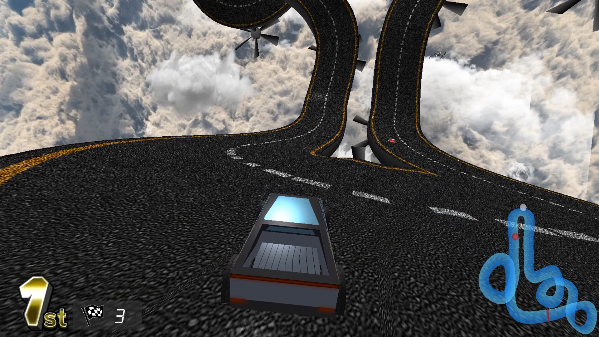
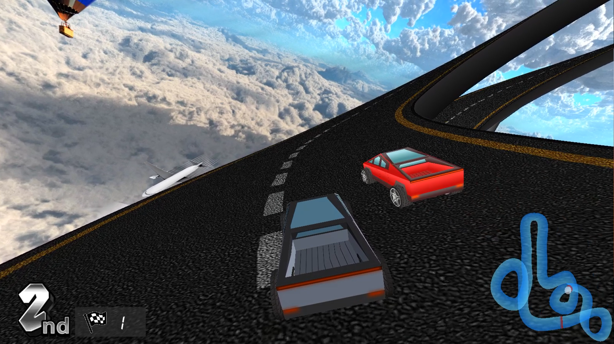
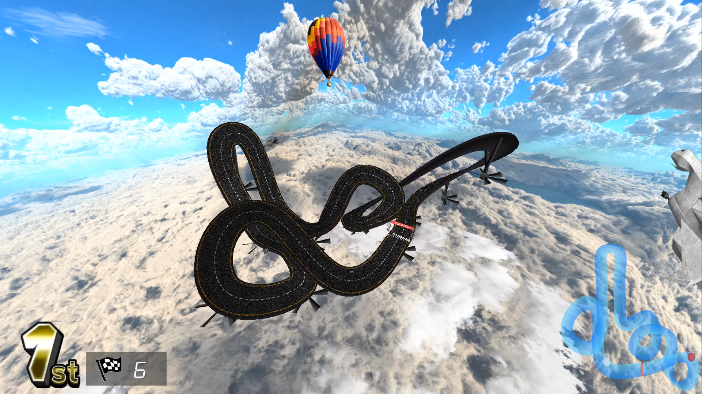

Construí un prototipo de carreras en el que puedes conducir por una pista suspendida en el aire, con desniveles y curvas inclinadas, mientras compites contra un rival automático. Una misma curva 3D define la forma del circuito y sirve de referencia para mover los autos sobre él.

[Ver el código fuente en GitHub](https://github.com/sebastianolmos/crazy_racer) · [Video de muestra](https://youtu.be/5rhhQ2h8ldA)

## Contexto y aporte personal

Desarrollé Crazy Racer como segunda tarea de **CC3501, Modelación y Computación Gráfica**, en la Universidad de Chile, durante el semestre de otoño de 2020. El desafío era convertir una curva espacial en una pista con ancho y espesor, y lograr que un vehículo controlado por teclado pudiera recorrerla siguiendo sus cambios de altura e inclinación.

Implementé la generación de la pista y el movimiento del vehículo sobre ella, e integré un rival automático, cámaras y un minimapa. Para la curva apliqué el método *Rounded Nonuniform Spline* descrito por Thomas Lowe en el capítulo 2.4 de *Game Programming Gems 4*. Reutilicé las utilidades gráficas del curso para las transformaciones, los grafos de escena y los shaders.

## Cómo funciona

**De 17 puntos a una pista transitable.** Al iniciar el programa, uno 17 puntos de control en 3D mediante tramos cúbicos de Hermite y cierro la curva conectando el último punto con el primero. Cada tramo ocupa una fracción del parámetro de avance proporcional a la distancia en línea recta entre sus extremos. Al muestrear la curva, calculo la tangente a partir de su derivada y la combino con una orientación interpolada para obtener el eje transversal. Desplazo un vértice hacia cada lado y conecto las secciones consecutivas con triángulos. Ajusté la orientación en algunos puntos de control para dar inclinación lateral a ciertos tramos.

**Del teclado a una posición sobre la pista.** El auto guarda dos coordenadas: el avance `t` a lo largo de la vuelta y el desplazamiento lateral `s` respecto del centro. En cada actualización, el programa propone un movimiento según el rumbo, la velocidad y el tiempo transcurrido. Mediante proyecciones locales estima las nuevas coordenadas y comprueba el límite lateral. Si el movimiento cabe dentro de la pista, reconstruye la posición 3D a partir de esas coordenadas. Si supera el límite, conserva la última posición válida y pone la velocidad en cero. Los ejes locales permiten que el auto acompañe la pendiente y la inclinación de la pista. El rival usa la misma representación y avanza con un desplazamiento lateral fijo.

## Tecnologías

Python, NumPy para la geometría, OpenGL mediante PyOpenGL para el renderizado, GLFW para la ventana y el teclado, Pillow para cargar texturas y Blender para el modelado del auto.

## Resultado y cómo comprobarlo

El resultado es un circuito cerrado y transitable. El auto acompaña los desniveles, se detiene al intentar salir por un borde y comparte la pista con un rival que avanza por su cuenta. El minimapa muestra la posición de ambos.

Con las dependencias del README instaladas, ejecuta `python crazy-racer.py` desde `code/`. Acelera con **W** y gira con **A** o **D** hacia un borde para comprobar que el auto se detiene. Pulsa **V** hasta llegar a la vista global para apreciar el trazado completo y sus cambios de altura. En el minimapa puedes seguir al rival incluso cuando queda fuera de la vista de la cámara.

## Limitación

El parámetro de avance usa las distancias rectas entre puntos de control como aproximación a la longitud de la curva. Por eso, aunque el rival incrementa `t` a un ritmo fijo, su rapidez en el espacio puede variar a lo largo del circuito.

## Capturas

