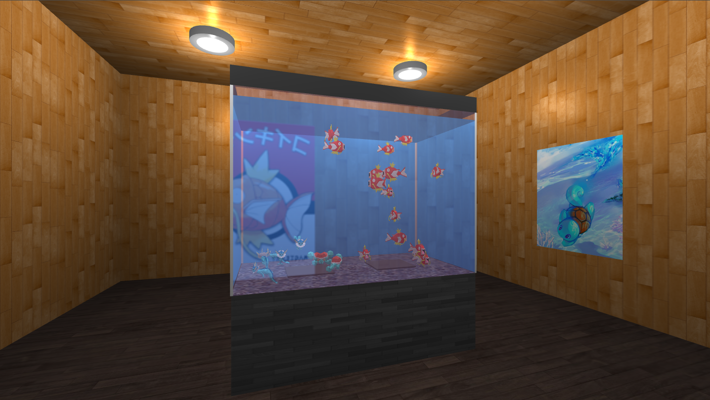
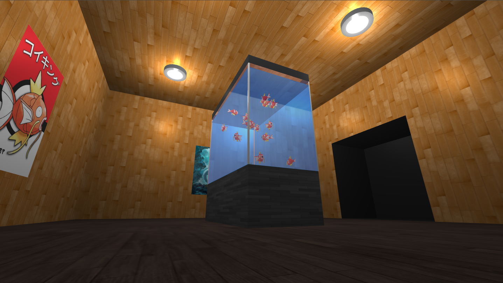
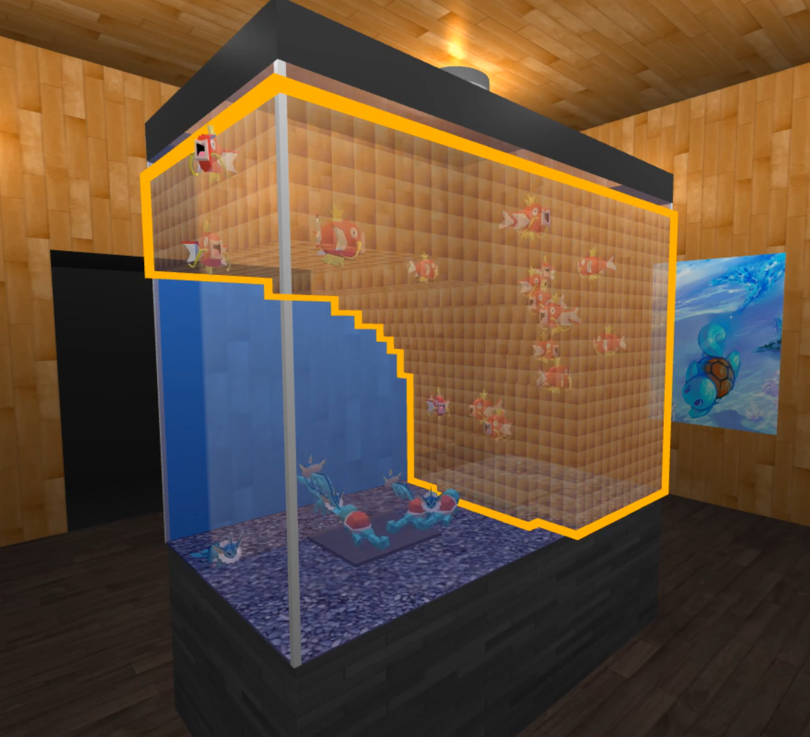
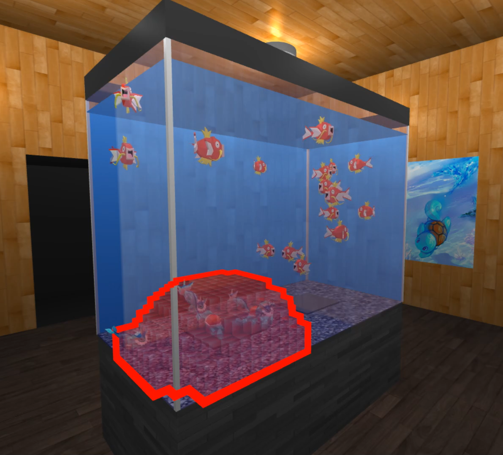
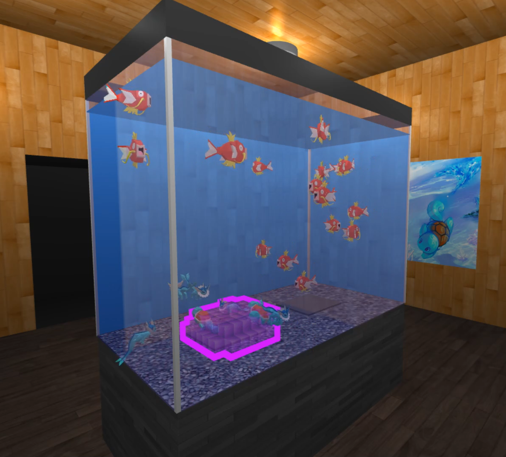
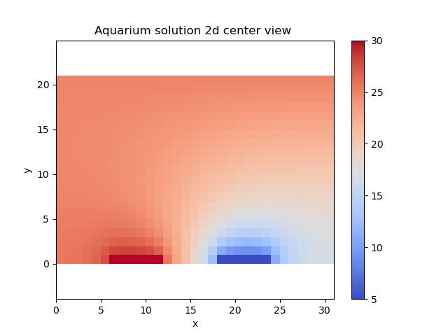
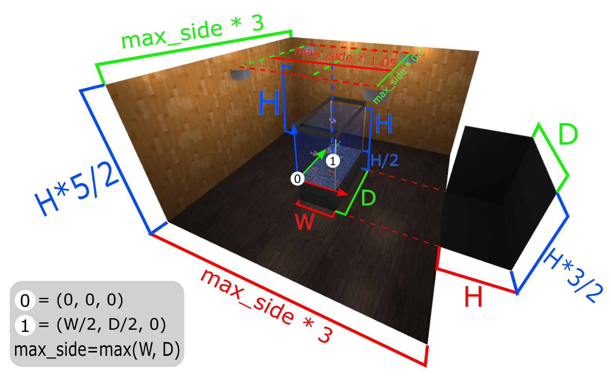

I built an interactive 3D aquarium that shows which areas of the water suit three types of fish based on temperature. The same calculation that defines the visible zones determines where the animated fish can swim.

[View the source code on GitHub](https://github.com/sebastianolmos/edp_aquarium) · [Watch the sample video](https://youtu.be/6nktvC8u2hk)

### Context and personal contribution

I developed this project for the third assignment in **Modeling and Computer Graphics (CC3501)** at the University of Chile during the fall of 2020. The challenge was to calculate the water temperature at equilibrium and turn the numerical result into a scene that could be explored.

I extended the finite difference method covered in class to three dimensions and implemented the viewer that connects the thermal calculation to the fish movement. I used the course's graphics utilities and adapted models of Vaporeon, Squirtle, and Magikarp in Blender to texture them and rig their tails.

### How it works

**From the equation to the grid.** The solver reads the aquarium dimensions and thermal parameters from a JSON file. It divides the volume into a regular grid with a step size equal to the longest side divided by 30. At each interior point, it approximates the Laplace equation using its six neighbors. At the boundaries, it accounts for ambient temperature at the surface, heat loss through the glass, and the fixed temperatures of two regulators at the bottom. Since each equation involves only a few points, the system is stored as a sparse matrix. SciPy solves it, and the program saves the temperature grid for the viewer to load directly.

**From the grid to movement.** For each fish type, the viewer marks cells within ±2 °C of its preferred temperature. This classification is used to build the visible mesh, choose initial positions, and decide which neighboring cells can be each fish's next destination. The mesh keeps only the exposed faces of the region, so enabling transparency reveals the volume as a shell. A stencil buffer highlights its outline.

### Technologies

Python, NumPy, SciPy, OpenGL with PyOpenGL and GLSL, GLFW, Pillow, and Matplotlib. Blender for adapting the 3D models.

### Outcome and how to try it

The viewer lets you inspect all three thermal regions and watch the fish move within them. To try it with the precomputed solution, run `python aquarium-view.py view-setup.json` from `code/`. Press **Q** to show the region and **B** to select Squirtle's. You should see a zone near **10 °C** close to the bottom. Use **A** and **C** to compare the other regions, and **V** to switch between the orbit camera and the first-person view.

The model represents an equilibrium state. To explore a different ambient temperature or change the regulator values, recalculate the grid and load it into the viewer.

### Screenshots

