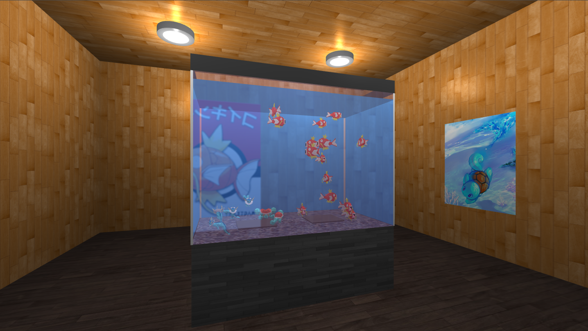
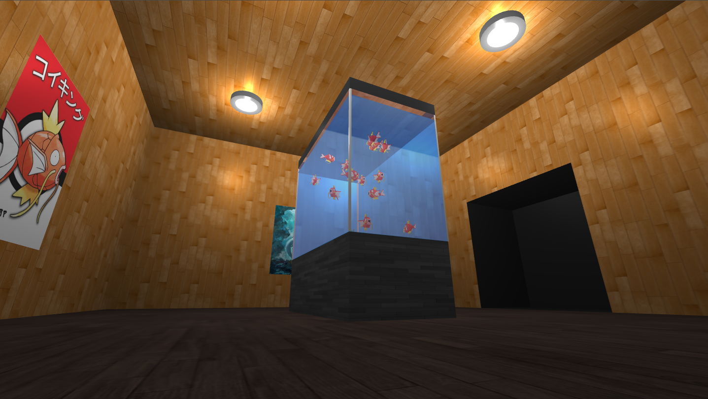
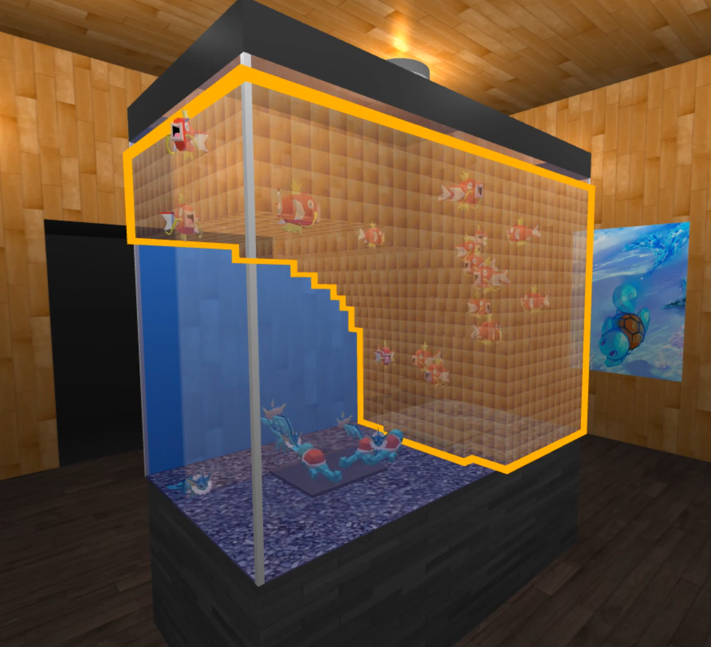
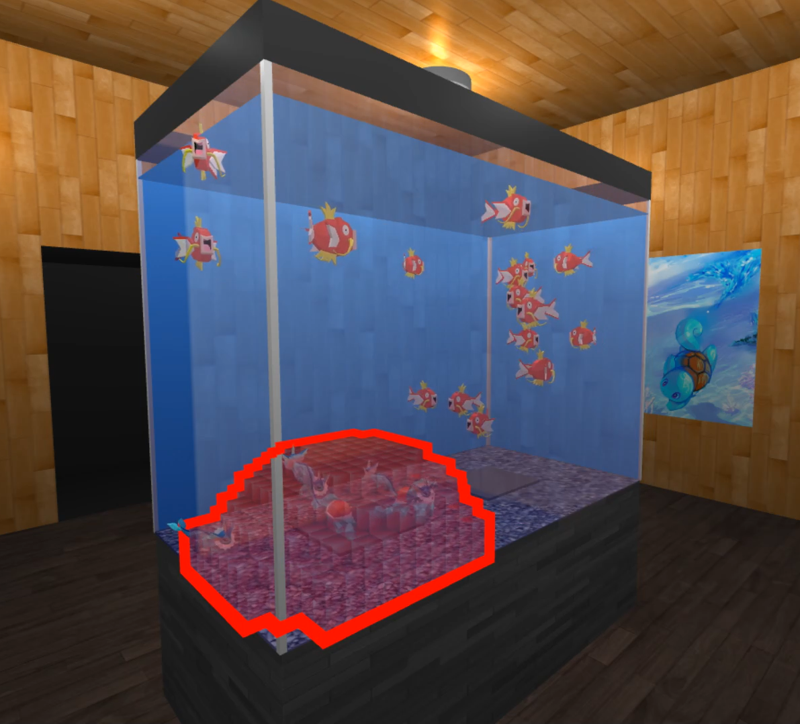
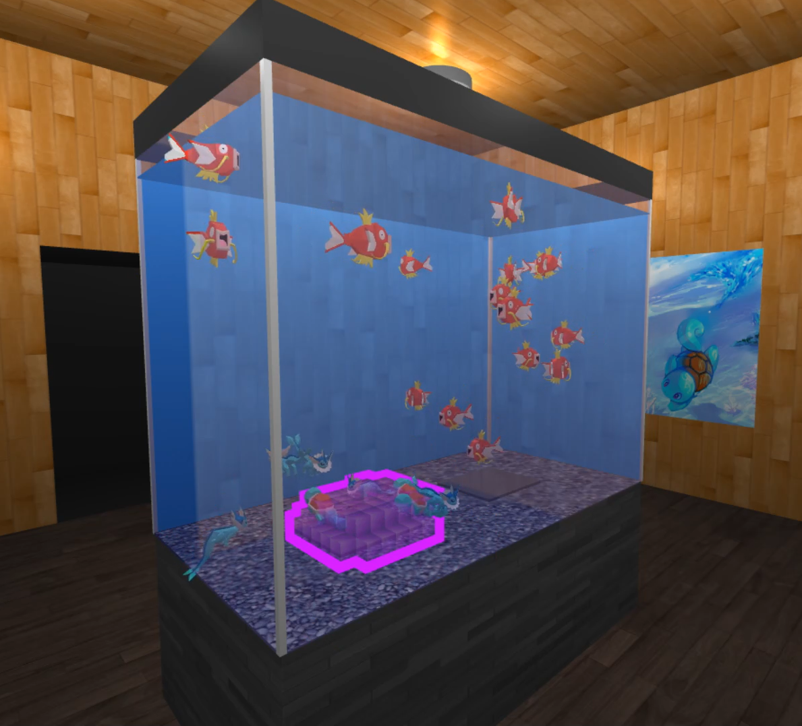
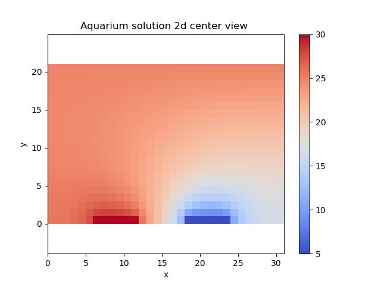
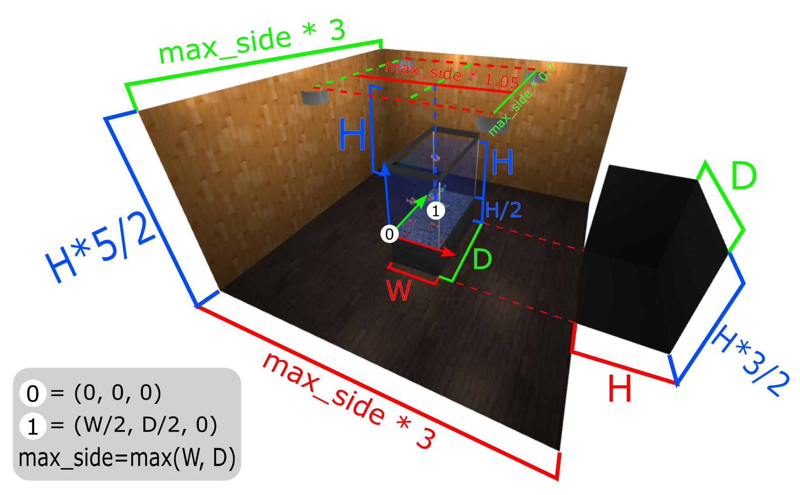

Construí un acuario 3D interactivo que muestra qué zonas del agua son adecuadas para tres tipos de peces según su temperatura. El mismo cálculo que define las zonas visibles determina por dónde pueden nadar los peces animados.

[Ver el código en GitHub](https://github.com/sebastianolmos/edp_aquarium) · [Video de muestra](https://youtu.be/6nktvC8u2hk)

### Contexto y aporte personal

Desarrollé este proyecto para la tercera tarea de **Modelación y Computación Gráfica (CC3501)** en la Universidad de Chile, durante el otoño de 2020. El desafío era calcular la temperatura del agua en equilibrio y convertir ese resultado numérico en una escena que se pudiera explorar.

Extendí a tres dimensiones el método de diferencias finitas trabajado en el curso e implementé el visor que conecta el cálculo térmico con el movimiento de los peces. Aproveché las utilidades gráficas del curso y adapté en Blender modelos de Vaporeon, Squirtle y Magikarp para texturizarlos y articular sus colas.

### Cómo funciona

**De la ecuación a la grilla.** El programa de cálculo lee las dimensiones del acuario y sus parámetros térmicos desde un JSON. Divide el volumen en una grilla regular, con un paso igual al lado mayor dividido por 30. En cada punto interior aproxima la ecuación de Laplace con sus seis vecinos. En los bordes incorpora la temperatura ambiente en la superficie, la pérdida térmica por los vidrios y las temperaturas fijas de dos reguladores en el fondo. Como cada ecuación involucra pocos puntos, el sistema se almacena en una matriz dispersa. SciPy lo resuelve y el programa guarda la grilla de temperaturas para que el visor pueda cargarla directamente.

**De la grilla al movimiento.** Para cada tipo de pez, el visor marca las celdas que están a ±2 °C de su temperatura preferida. Esa clasificación sirve para construir la malla visible, elegir posiciones iniciales y decidir qué celdas vecinas pueden ser el próximo destino de cada pez. La malla conserva solo las caras expuestas de la región, por lo que al activar la transparencia se aprecia el volumen como una envolvente. Un búfer de esténcil resalta su contorno.

### Tecnologías

Python, NumPy, SciPy, OpenGL con PyOpenGL y GLSL, GLFW, Pillow y Matplotlib. Blender para la adaptación de los modelos 3D.

### Resultado y cómo comprobarlo

El visor permite inspeccionar las tres regiones térmicas y observar el movimiento de los peces dentro de ellas. Para probarlo con la solución precalculada, ejecuta `python aquarium-view.py view-setup.json` desde `code/`. Pulsa **Q** para mostrar la región y **B** para seleccionar la de Squirtle. Deberías ver una zona alrededor de los **10 °C** cerca del fondo. Con **A** y **C** puedes comparar las otras regiones, y con **V** cambiar entre la cámara orbital y la vista en primera persona.

El modelo representa un estado de equilibrio. Para explorar otra temperatura ambiente o cambiar los valores de los reguladores, hay que volver a calcular la grilla y cargarla en el visor.

### Capturas

