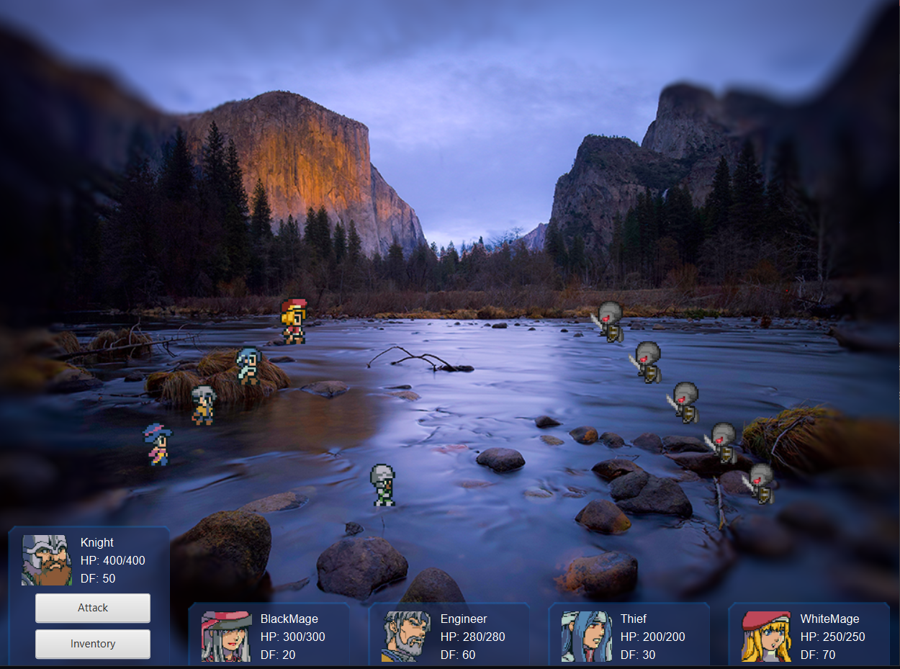
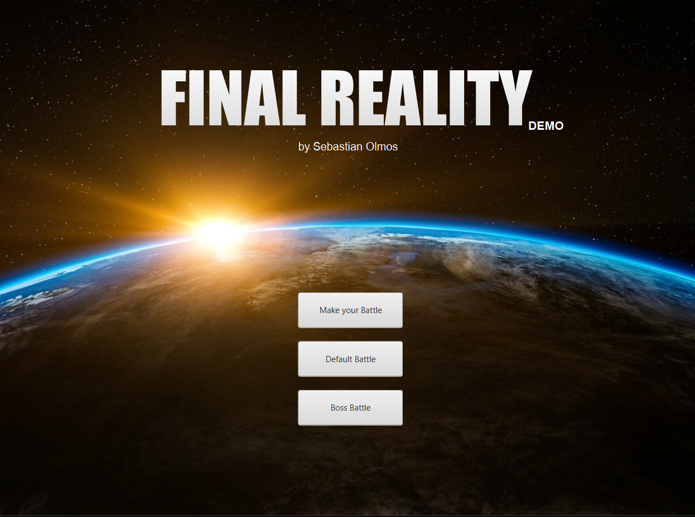
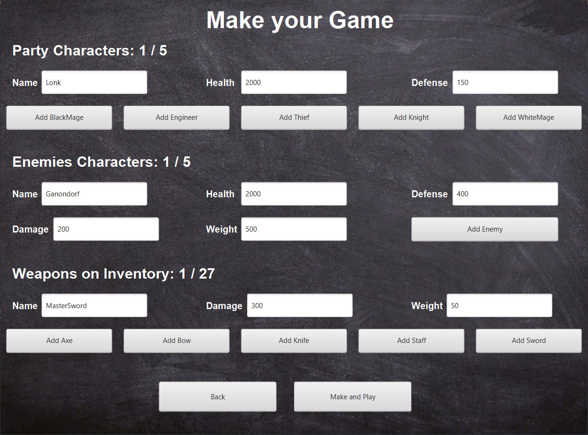
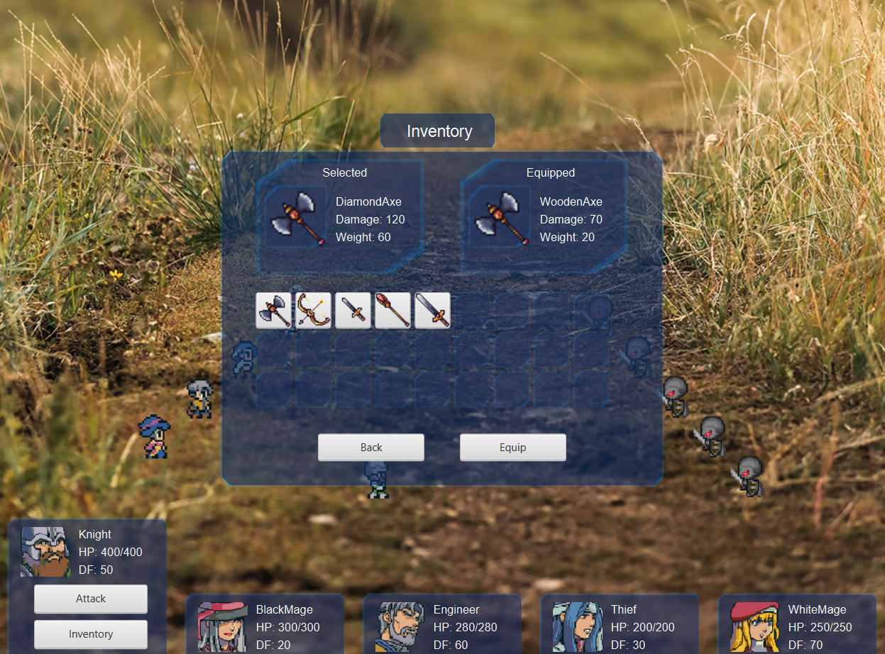
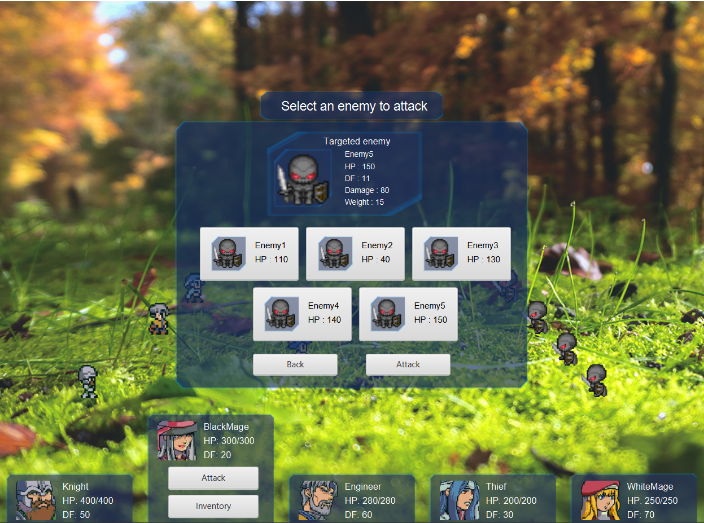

I developed a desktop turn-based combat demo inspired by *Final Fantasy*. You can lead a party of characters against computer-controlled enemies, change their equipment during battle, and play preset battles or configure your own.

[View the source code on GitHub](https://github.com/sebastianolmos/final-reality) · [Watch the demo video](https://youtu.be/kwJvuvLzh-g) · [View the inventory screenshot](finalreality_03.png)

### Context and personal contribution

Final Reality was my semester project for **Design and Programming Methodologies (CC3002)** at the University of Chile. The challenge was to coordinate player decisions with the enemies' automatic turns and bring that flow into a graphical interface. I started with the course starter code, which included an initial model and turn timers. I expanded the character and weapon model, implemented the battle controller and its phases, and built the screens for preparing, playing, and viewing the result of a battle. I also added model and controller tests.

### How it works and technical decisions

In **Default Battle**, the knight takes the first turn. From **Inventory**, you can compare weapon damage and weight, change the knight's axe, and return to the action menu. Then, under **Attack**, choose an enemy and confirm. The model subtracts the target's defense from the weapon's damage, with a minimum of zero. If an enemy loses all its health points, the controller receives a notification and checks whether any opponents remain. On their turns, enemies randomly choose a living party member.

**Turn phases.** I implemented the State pattern so the controller delegates actions to the active phase. Equipping a weapon lets the player continue making decisions in the same turn. Confirming an attack requires a selected target and ends the turn. When a turn ends, the character leaves the queue and a timer schedules their return at the end. With the knight's starting axe, which has 70 base damage, the wait is 2 seconds. With the *DiamondAxe*, which has 120 base damage, it is 6 seconds. This changes both the hit and how long it takes for the character to become available again.

**Equipment compatibility.** I used double dispatch so equipment changes depend on both the character class and the weapon type. The knight delegates the operation to the weapon, which determines whether it can be equipped by that class. This lets the knight swap the axe for another compatible weapon and return the previous one to the inventory. If the knight tries to equip a bow, the current weapon stays equipped and the inventory remains unchanged.

### Technologies

Java 11, JavaFX for the interface, Gradle for building, JUnit 5 for tests, and JaCoCo for code coverage.

### Outcome and how to verify it

The demo supports a complete battle, from selecting or configuring the teams to the victory or defeat screen. To check the effect of equipment, open **Default Battle**, equip the *DiamondAxe* on the first turn, and attack **Enemy1**. The enemy starts with 110 health points and 22 defense. When you select it again on a later party turn, the panel should show **12 health points**. The repository also includes `BasicPlaysTest.winningPlayTest`, which uses the controller to verify equipping a sword, an enemy counterattack, and victory after defeating the last opponent.

### Scope

Combat actions in this version are equipping weapons and attacking. Mages have their own equipment rules and participate through weapon attacks. Spells and status effects were outside the scope of the demo.

### Screenshots

