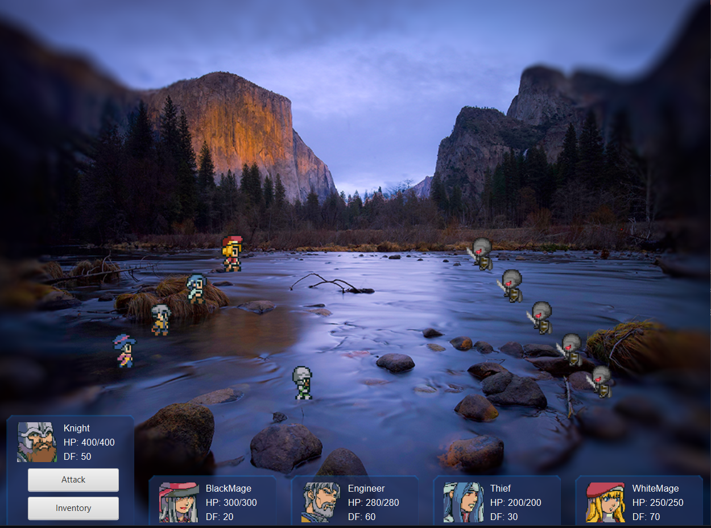
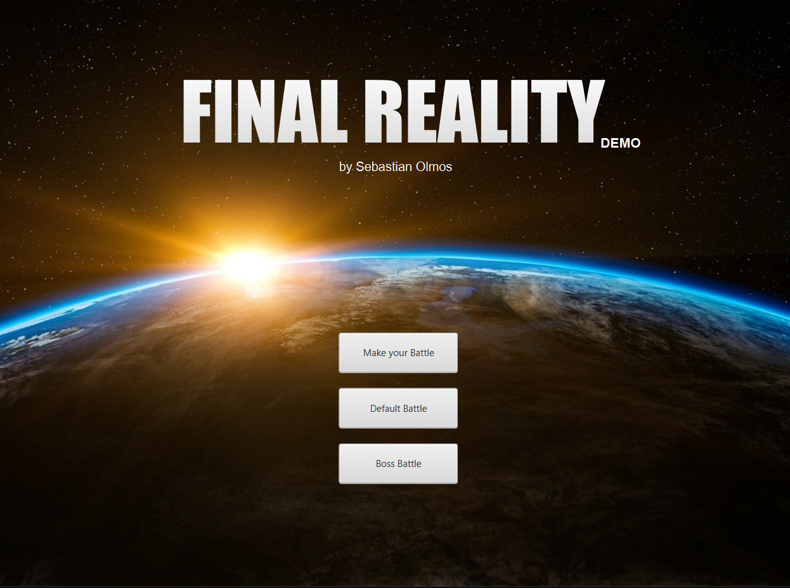
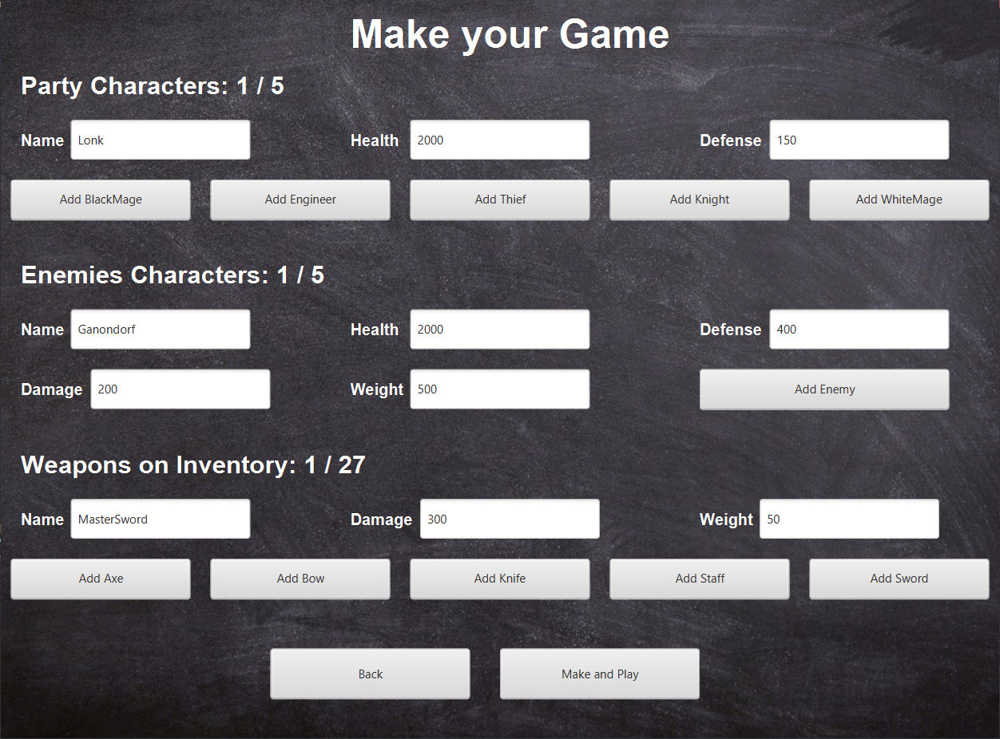
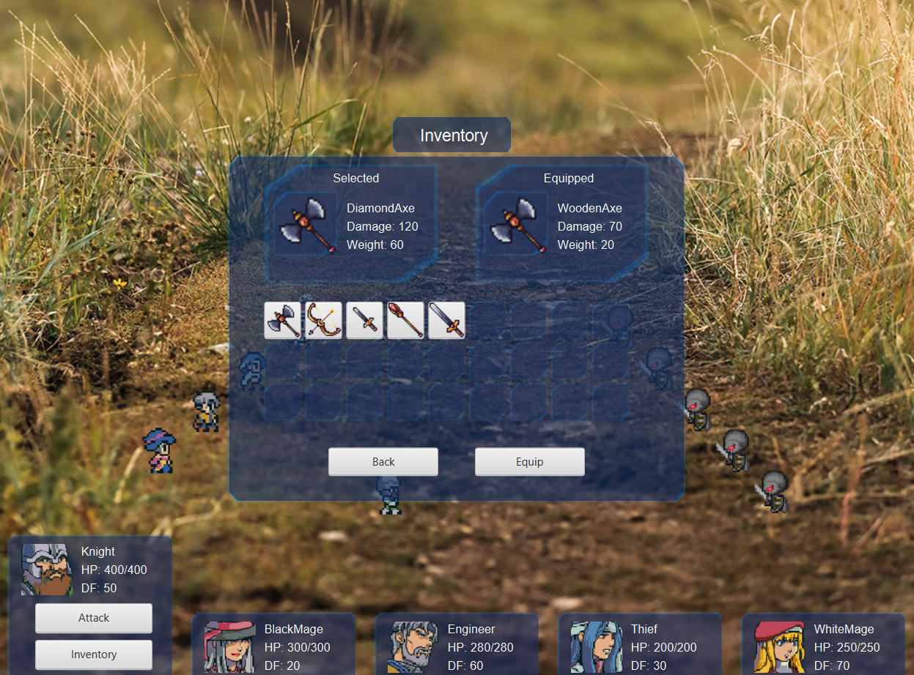
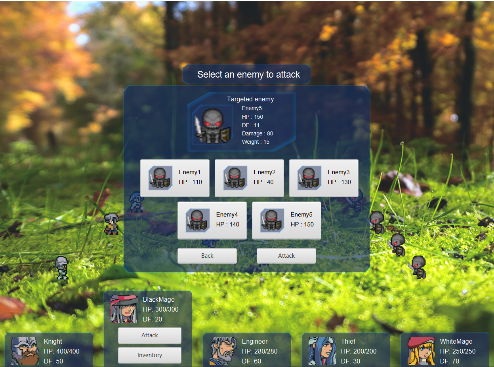

Desarrollé una demo de escritorio de combate por turnos inspirada en *Final Fantasy*. Puedes dirigir a un grupo de personajes contra enemigos controlados por la computadora, cambiar su equipo durante el combate y jugar batallas predefinidas o configurar las tuyas.

[Ver el código fuente en GitHub](https://github.com/sebastianolmos/final-reality) · [Video de demostración](https://youtu.be/kwJvuvLzh-g) · [Captura del inventario](finalreality_03.png)

### Contexto y aporte personal

Final Reality fue mi proyecto semestral para **Metodologías de Diseño y Programación (CC3002)** en la Universidad de Chile. El desafío era coordinar las decisiones del jugador con los turnos automáticos de los enemigos y llevar ese flujo a una interfaz gráfica. Partí del código base del curso, que incluía un modelo inicial y temporizadores para los turnos. Amplié el modelo de personajes y armas, implementé el controlador de combate y sus fases, y construí las pantallas para preparar, jugar y ver el resultado de una batalla. También añadí pruebas del modelo y del controlador.

### Cómo funciona y decisiones técnicas

En **Default Battle**, el primer turno es del caballero. Desde **Inventory** puedes comparar el daño y el peso de las armas, cambiar su hacha y volver al menú de acciones. Después, en **Attack**, eliges un enemigo y confirmas. El modelo resta la defensa del objetivo al daño del arma, con un mínimo de cero. Si el enemigo pierde todos sus puntos de vida, el controlador recibe una notificación y comprueba si quedan oponentes. Los enemigos, en su turno, eligen al azar a un integrante vivo del grupo.

**Fases del turno.** Implementé el patrón Estado para que el controlador delegue las acciones a la fase activa. Equipar un arma permite seguir tomando decisiones en el mismo turno. Confirmar un ataque requiere haber seleccionado un objetivo y cierra el turno. Al cerrarlo, el personaje sale de la cola y un temporizador programa su regreso al final. Con el hacha inicial del caballero, de 70 puntos de daño base, esa espera es de 2 segundos. Con la *DiamondAxe*, de 120 puntos de daño base, es de 6 segundos. El cambio afecta tanto al golpe como al tiempo que tarda el personaje en volver a estar disponible.

**Compatibilidad del equipo.** Apliqué doble despacho para que el cambio dependa de la clase del personaje y del tipo de arma. El caballero delega la operación al arma, que define si puede equiparse en esa clase. Así, puede cambiar su hacha por otra compatible y devolver la anterior al inventario. Si intenta equipar un arco, conserva su arma y el inventario queda igual.

### Tecnologías

Java 11, JavaFX para la interfaz, Gradle para la compilación, JUnit 5 para las pruebas y JaCoCo para la cobertura.

### Resultado y cómo comprobarlo

La demo permite jugar un combate completo, desde la selección o configuración de los equipos hasta la pantalla de victoria o derrota. Para comprobar el efecto del equipamiento, abre **Default Battle**, equipa la *DiamondAxe* en el primer turno y ataca a **Enemy1**. El enemigo empieza con 110 puntos de vida y 22 de defensa. Al volver a seleccionarlo en un turno posterior del grupo, el panel debería mostrar **12 puntos de vida**. El repositorio también incluye `BasicPlaysTest.winningPlayTest`, que comprueba desde el controlador el equipamiento de una espada, el contraataque enemigo y la victoria al derrotar al último rival.

### Alcance

Las acciones de combate de esta versión son equipar armas y atacar. Los magos tienen sus propias reglas de equipamiento y participan mediante ataques con armas. Los hechizos y los efectos de estado quedaron fuera de la demo.

### Capturas

