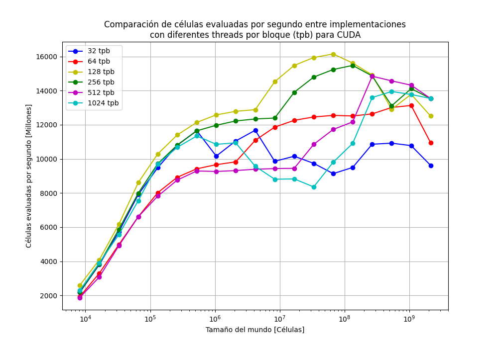
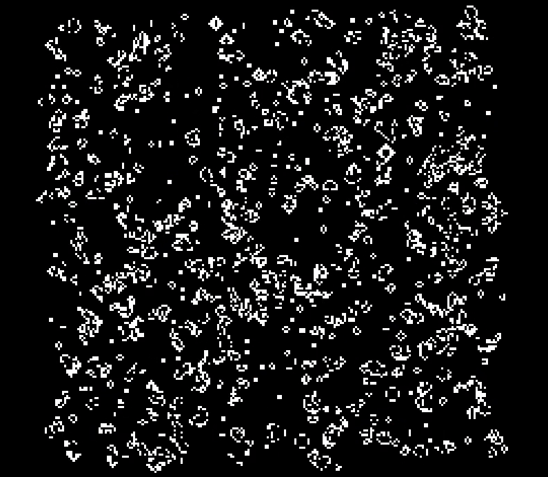
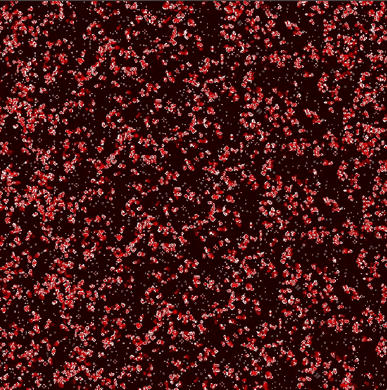

I implemented and compared CPU and GPU versions of Conway's Game of Life to measure how performance changes as the board grows. The project includes an interactive visualizer for following cell evolution and distinguishing births from deaths.

[View the source code on GitHub](https://github.com/sebastianolmos/game_of_life) · [GIF demo: 128 board](https://github.com/sebastianolmos/game_of_life/blob/main/captures/gol128.gif) · [GIF demo: 512 board](https://github.com/sebastianolmos/game_of_life/blob/main/captures/gol512_2.gif) · [Visualizer controls](https://github.com/sebastianolmos/game_of_life/blob/main/GameOfLifeVisualization/README.md#controles)

## Context and personal contribution

The project began in 2021 as the second assignment for the **GPU Computing (CC7515-1)** course at the University of Chile. I studied how many cells per second each implementation could update and at what board sizes using the GPU became advantageous. I adapted Marek Fiser's basic implementation into command-line programs for the CPU and CUDA, then automated timing collection in Python. I also implemented OpenCL versions and generated the charts. After submitting the assignment, I added a visualizer based on the same reference project, with pan, zoom, and speed controls. [Marek Fiser's project](http://www.marekfiser.com/Projects/Conways-Game-of-Life-on-GPU-using-CUDA)

## How it works

A CUDA run takes the width, height, number of generations, and threads per block as input. The program generates a random board, stores each cell as a byte with a value of `0` or `1`, and copies the initial state to the GPU. At each generation, threads calculate the state of their assigned cells from their eight neighbors. Opposite edges wrap around, so a cell at the left edge also has neighbors at the right edge.

The update uses **two buffers**. All threads read the previous generation and write the next one to a separate buffer. When the update finishes, the buffers swap roles. This lets each cell be calculated from the same previous state and keeps the board on the GPU between generations. To study the cost of the calculation, we compared one version that directly sums the values of the eight neighbors with another that checks each state using explicit `if` statements. We also tested block sizes that are and are not multiples of 32.

The visualizer shares a pixel buffer between CUDA and OpenGL. A kernel converts the new generation into colors, and OpenGL uses them to update a texture the size of the board. Zoom and pan are applied when drawing that texture, while the simulation state remains on the GPU. [Basic reference implementation](http://www.marekfiser.com/Projects/Conways-Game-of-Life-on-GPU-using-CUDA) · [Reference visualization code](https://github.com/sebastianolmos/game_of_life/tree/main/GameOfLifeVisualization)

## Technologies

C++, CUDA, and OpenCL for computation · OpenGL 3.3, GLFW, GLAD, and GLM for visualization · Python, NumPy, and Matplotlib for measurements and charts.

## Outcome and how to verify it

On a **4096 × 4096 cell board**, five generations took a total of **1,573.39 ms** on an Intel Core i7-8750H and **5.42 ms** on a 6 GB NVIDIA GeForce GTX 1060 with 128 threads per block. The ratio between the recorded times is about **290×**. With the same board and block sizes, the CUDA variant with explicit `if` statements recorded **7.36 ms**. See the data: [CPU series](https://github.com/sebastianolmos/game_of_life/blob/main/Data/serial_CPU.csv) · [CUDA series](https://github.com/sebastianolmos/game_of_life/blob/main/Data/cuda_128tpb.csv) · [CUDA series with `if`](https://github.com/sebastianolmos/game_of_life/blob/main/Data/cuda_128tpb_if.csv).

You can reproduce the ratio by dividing the times in the `4096,4096,5` row of the first two CSV files. To watch the simulation run, open one of the GIF demos linked above: the color effect highlights newly born cells in white and cells that have just died in red. In the application, press `P` to toggle post-processing. [Demo and controls](https://github.com/sebastianolmos/game_of_life/tree/main/GameOfLifeVisualization)

## Screenshots

