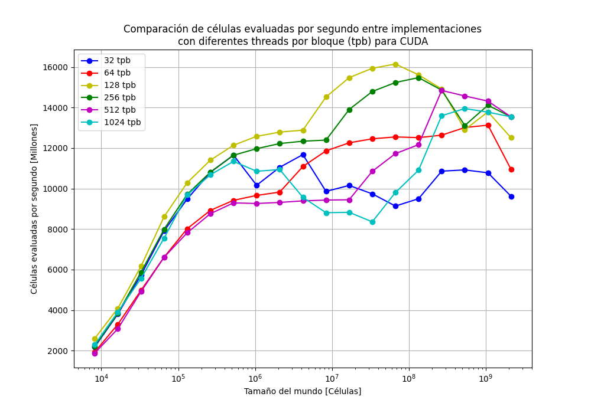
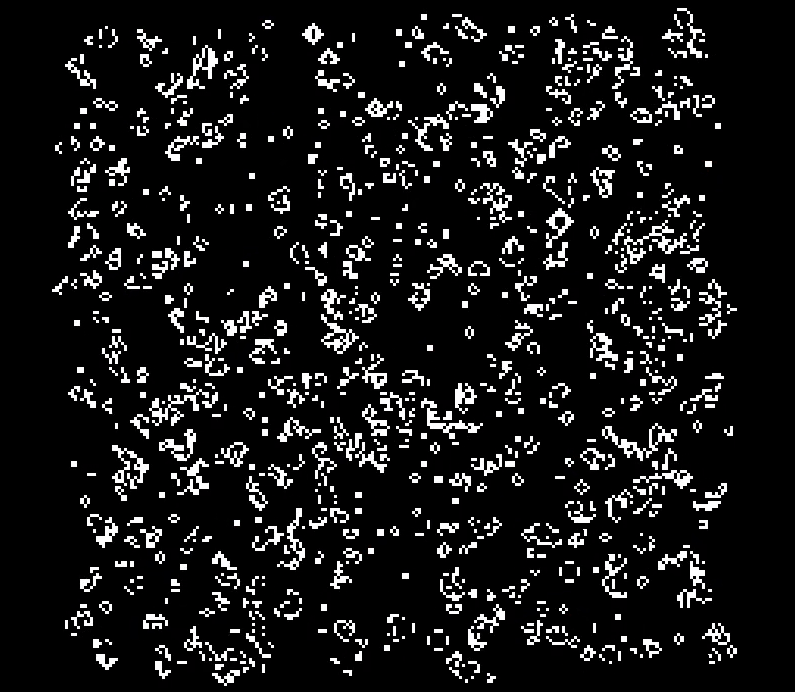
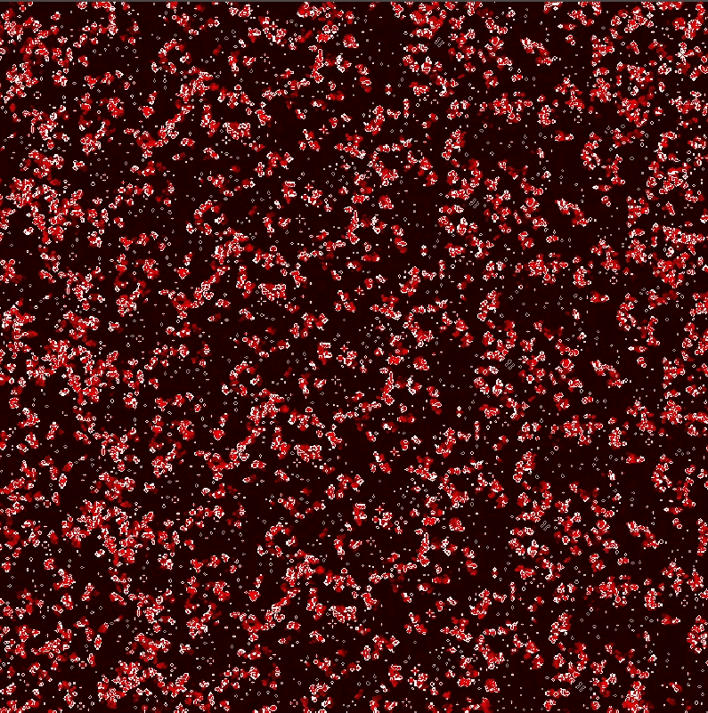

Implementé y comparé versiones del Juego de la Vida de Conway en CPU y GPU para medir cómo cambia el rendimiento al aumentar el tamaño del tablero. El proyecto incluye un visualizador interactivo para seguir la evolución de las celdas y distinguir nacimientos y muertes.

[Ver el código en GitHub](https://github.com/sebastianolmos/game_of_life) · [Demo en GIF: tablero 128](https://github.com/sebastianolmos/game_of_life/blob/main/captures/gol128.gif) · [Demo en GIF: tablero 512](https://github.com/sebastianolmos/game_of_life/blob/main/captures/gol512_2.gif) · [Controles del visualizador](https://github.com/sebastianolmos/game_of_life/blob/main/GameOfLifeVisualization/README.md#controles)

## Contexto y aporte personal

El proyecto surgió en 2021 como la segunda tarea de **Computación en GPU (CC7515-1)** de la Universidad de Chile. Estudié cuántas celdas por segundo podía actualizar cada implementación y para qué tamaños de tablero resultaba ventajoso usar la GPU. Adapté la implementación básica de Marek Fiser a programas de línea de comandos para CPU y CUDA y automaticé la recolección de tiempos en Python. También implementé las versiones en OpenCL y los gráficos. Después de la entrega incorporé un visualizador basado en el mismo proyecto de referencia, con controles de desplazamiento, zoom y velocidad. [Proyecto de Marek Fiser](http://www.marekfiser.com/Projects/Conways-Game-of-Life-on-GPU-using-CUDA)

## Cómo funciona

Una corrida en CUDA recibe el ancho, el alto, el número de generaciones y los hilos por bloque. El programa genera un tablero aleatorio, guarda cada celda como un byte con valor `0` o `1` y copia el estado inicial a la GPU. En cada generación, los hilos calculan el estado de las celdas que les corresponden a partir de sus ocho vecinas. Los bordes opuestos se conectan, de modo que una celda del extremo izquierdo también tiene vecinas en el extremo derecho.

La actualización usa **dos búferes**. Todos los hilos leen la generación anterior y escriben la siguiente en un búfer separado. Al terminar, los búferes intercambian sus roles. Así, cada celda se calcula a partir del mismo estado previo y el tablero permanece en la GPU entre generaciones. Para estudiar el costo del cálculo, comparamos una versión que suma directamente los valores de las ocho vecinas con otra que consulta cada estado mediante `if` explícitos. También probamos tamaños de bloque múltiplos y no múltiplos de 32.

El visualizador comparte un búfer de píxeles entre CUDA y OpenGL. Un kernel convierte la nueva generación en colores y OpenGL los usa para actualizar una textura del tamaño del tablero. El zoom y el desplazamiento se aplican al dibujar esa textura, con el estado de la simulación todavía en la GPU. [Implementación básica de referencia](http://www.marekfiser.com/Projects/Conways-Game-of-Life-on-GPU-using-CUDA) · [Código y visualización de referencia](https://github.com/sebastianolmos/game_of_life/tree/main/GameOfLifeVisualization)

## Tecnologías

C++, CUDA y OpenCL para el cálculo · OpenGL 3.3, GLFW, GLAD y GLM para la visualización · Python, NumPy y Matplotlib para las mediciones y los gráficos.

## Resultado y cómo comprobarlo

En un tablero de **4096 × 4096 celdas**, cinco generaciones acumularon **1.573,39 ms** en un Intel Core i7-8750H y **5,42 ms** en una NVIDIA GeForce GTX 1060 de 6 GB con 128 hilos por bloque. El cociente entre los tiempos registrados es de unas **290 veces**. Con el mismo tamaño de tablero y de bloque, la variante CUDA con `if` explícitos registró **7,36 ms**. Puedes consultar los datos: [serie CPU](https://github.com/sebastianolmos/game_of_life/blob/main/Data/serial_CPU.csv) · [serie CUDA](https://github.com/sebastianolmos/game_of_life/blob/main/Data/cuda_128tpb.csv) · [serie CUDA con `if`](https://github.com/sebastianolmos/game_of_life/blob/main/Data/cuda_128tpb_if.csv).

El cociente se reproduce dividiendo los tiempos de la fila `4096,4096,5` de los dos primeros CSV. Para ver la simulación en marcha, abre una de las demostraciones GIF enlazadas arriba: el efecto de color resalta en blanco las celdas que nacen y en rojo las que mueren. En la aplicación, la tecla `P` activa o desactiva el posprocesado. [Demo y controles](https://github.com/sebastianolmos/game_of_life/tree/main/GameOfLifeVisualization)

## Capturas

