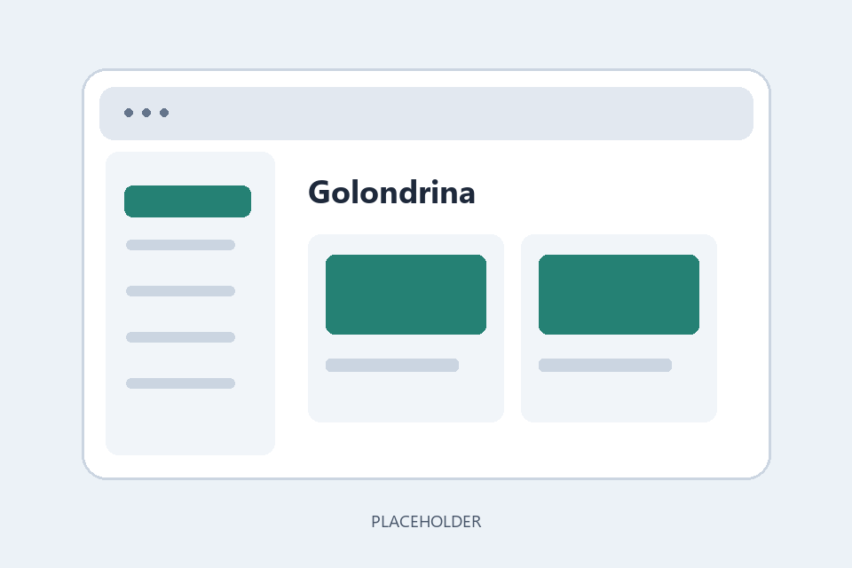

## Problema

Aquí describiré el problema que busca resolver Golondrina.

## Solución

Aquí explicaré el enfoque que seguí y el resultado del proyecto.

## Captura

## Código y demo

Por completar con el repositorio y la demo, si están disponibles.
