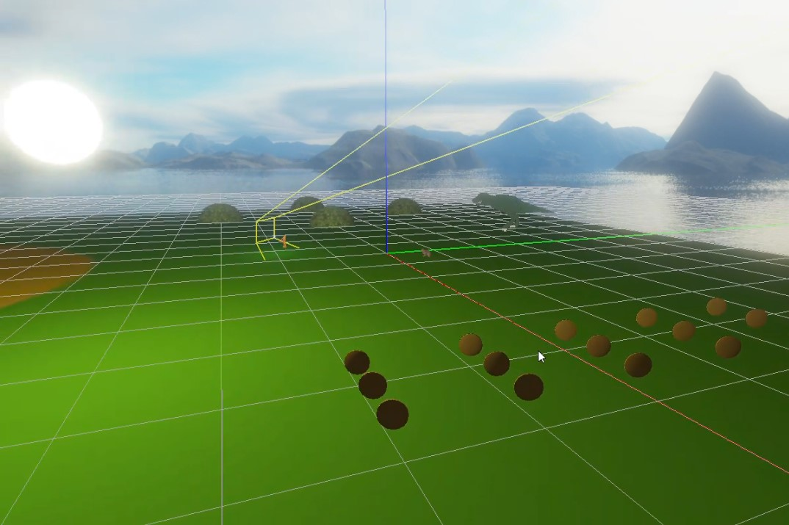
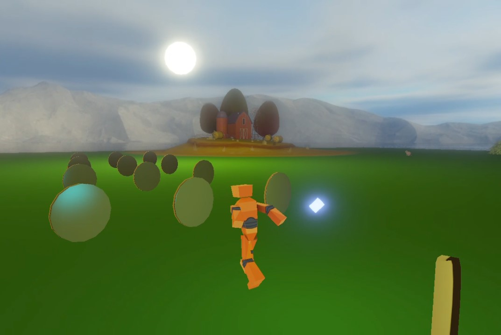
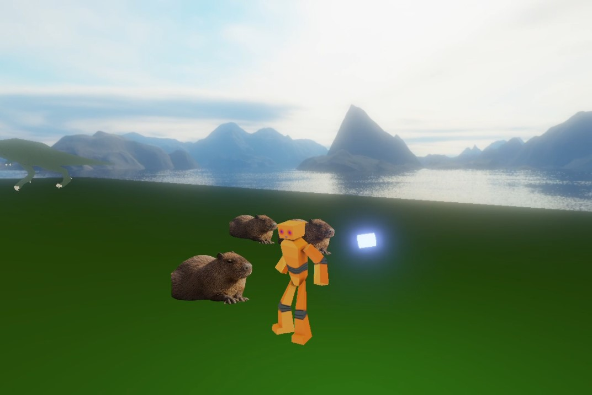
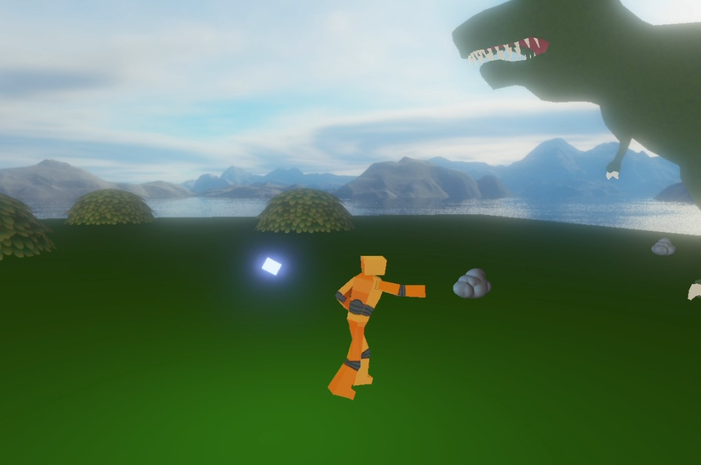
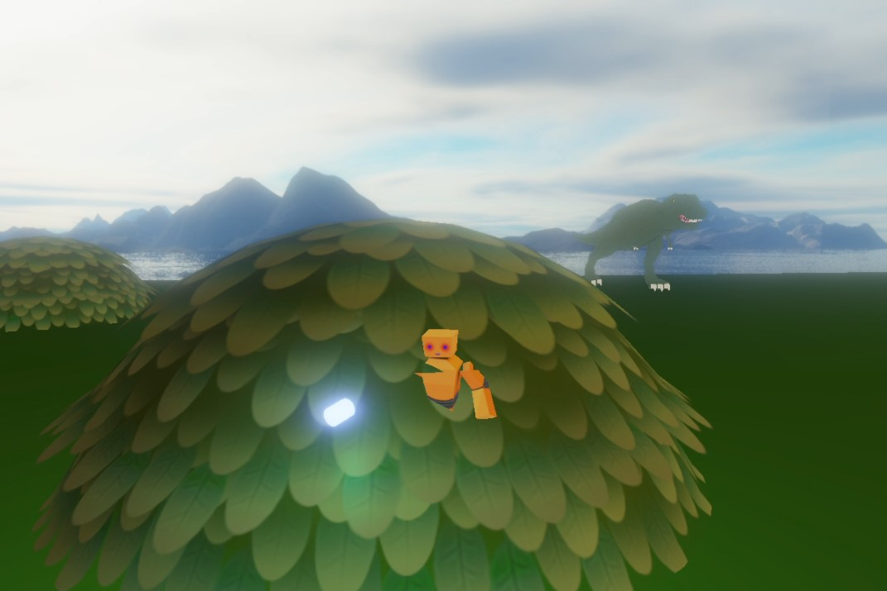
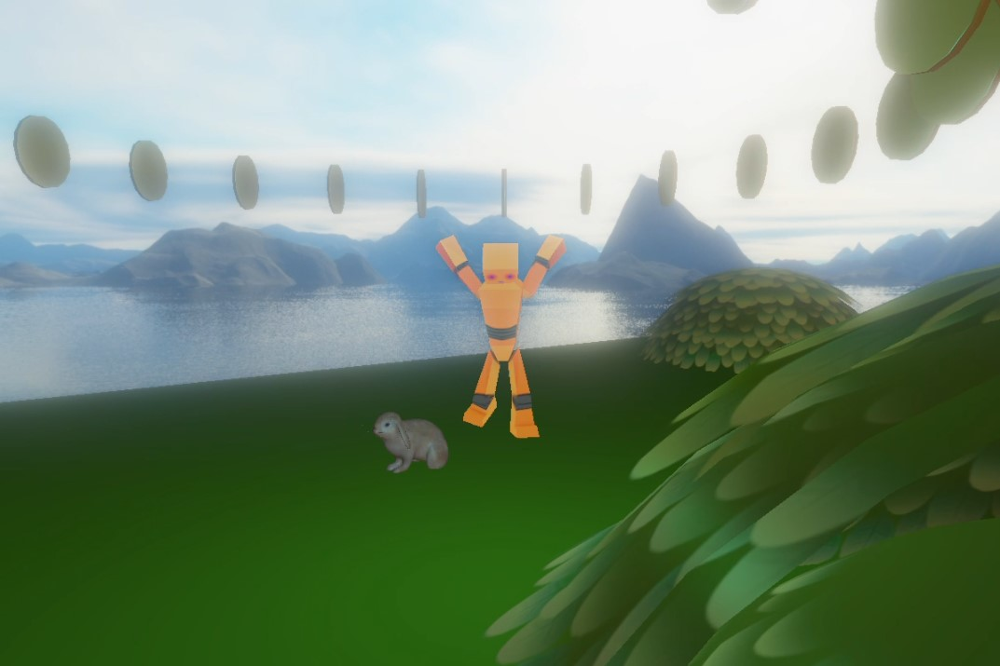
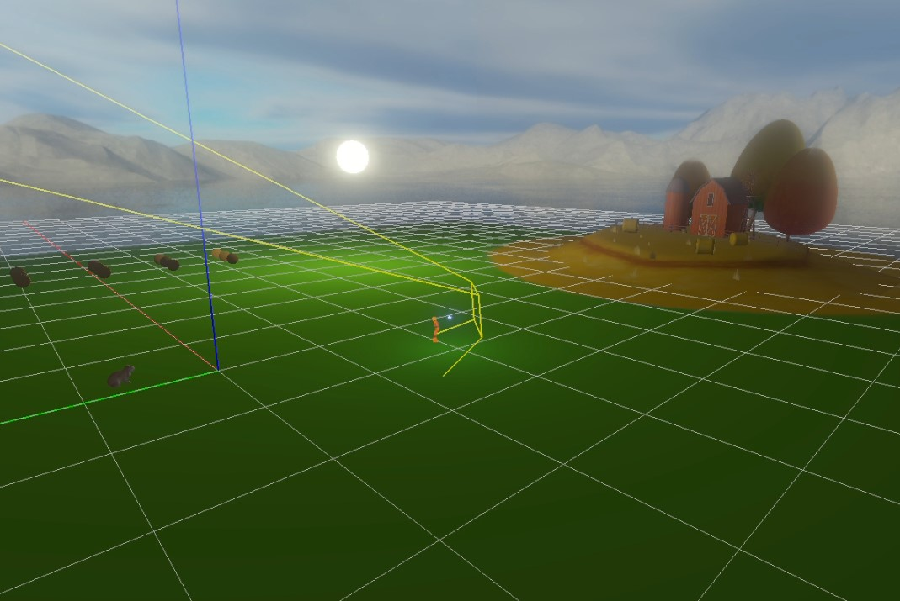

I built a 3D engine for small third-person exploration games. Its demo, *CatchGame*, lets you explore a farm with an animated robot, chase a rabbit, and collect coins.

[View the source code on GitHub](https://github.com/sebastianolmos/JourneyEngine)

## Context and personal contribution

I built Journey Engine in 2022 for the Game Engine Architecture course (CC5512) at the University of Chile. I developed it throughout the semester in incremental milestones. I wanted to create a tool for practicing the design of small 3D exploration worlds, drawing inspiration from games such as *A Short Hike* and *Lonely Mountains: Downhill*.

I implemented Journey Engine as a static library and built CatchGame as an application that uses it. LearnOpenGL was my main technical reference, particularly for skeletal animation and bloom. I integrated those techniques into the scene update cycle, added name-based animation clip registration, and connected playback to character movement. I also implemented the entity hierarchy and the demo logic.

## From controller input to the character on screen

When you move the left stick, *CatchGame* receives the controller axes through two name-registered actions. Each frame, the engine reads the input and updates the character. It calculates position from the time elapsed since the previous frame and adjusts the movement direction to the camera orientation. Once the character exceeds a speed threshold, the game starts the running animation.

**One entity handles control, another holds the mesh.** The parent entity stores the player's position and runs the movement logic. Bob, the robot shown on screen, is a child entity with a skeletal mesh component. As the engine traverses the scene, it combines the parent entity's transform with Bob's. The model follows the character while keeping its own scale and local orientation.

**The CPU calculates the pose; the GPU deforms the mesh.** I integrated skeletal animation into the scene update cycle and added name-based clip registration. With Assimp, the engine reads the mesh, bone weights, and animation clips from the same FBX file. Each frame, the CPU interpolates bone positions and scales, interpolates rotations with quaternions, and calculates pose matrices following the skeleton hierarchy. The vertex shader uses those matrices to calculate each vertex position, weighting the influence of up to four bones.

## Technologies

C++20, OpenGL 3.3 and GLSL for graphics, GLFW for windows and input, GLM for math, Assimp for model and animation import, OpenAL Soft for audio, and CMake for building.

## Outcome and how to try it

The final milestone brought the engine systems together in a small exploration game with a follow camera, an animated character, and a collection mechanic. When Bob catches the rabbit, it stops and scatters coins that can be collected by proximity. The scene also includes HDR post-processing and *bloom* to create a glow around the brightest areas.

To try it with a Windows build, run `CatchGame.exe` from `build/games/Release` with a controller connected. Move the left stick and then release it. The camera should follow Bob, and the character should switch from idle to running and back to idle when it stops. The repository includes setup instructions.

## Scope

The demo builds its environment in code at startup. Cascaded shadows and character dialogue remained future improvements.

## Screenshots

