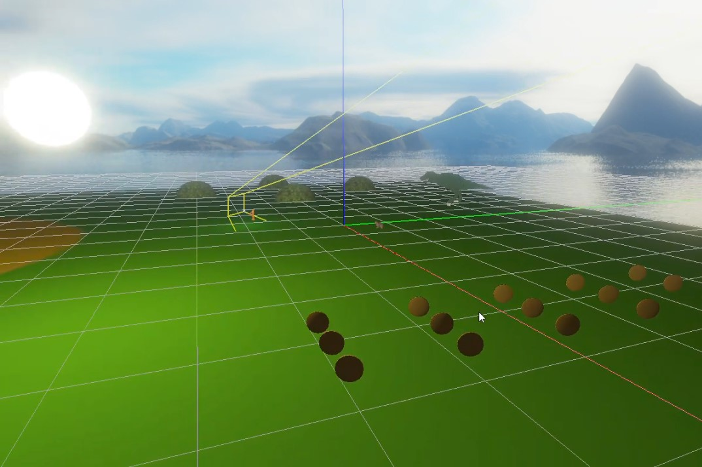
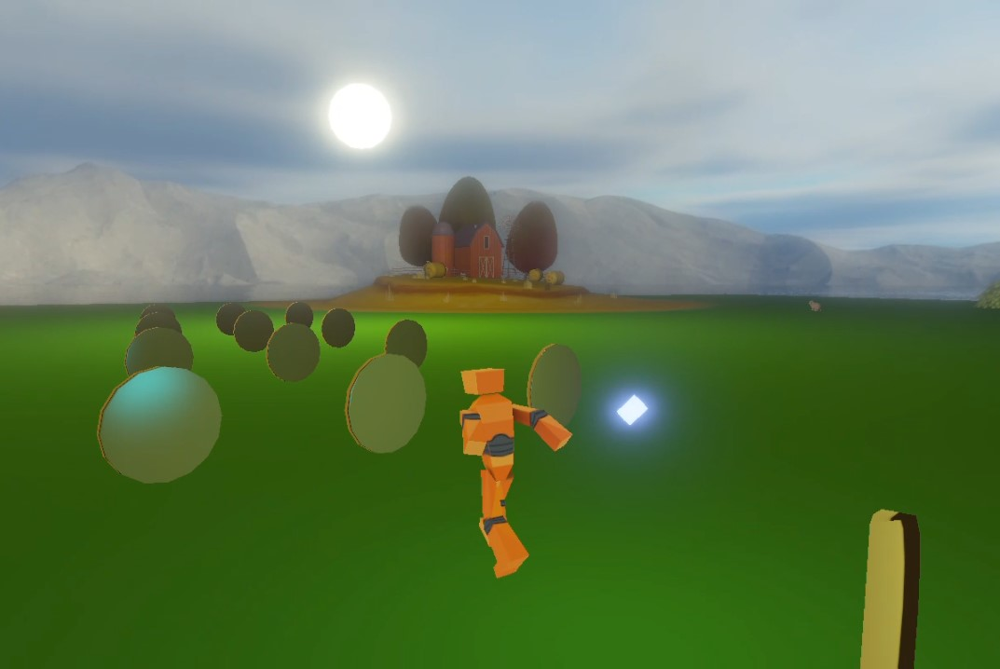
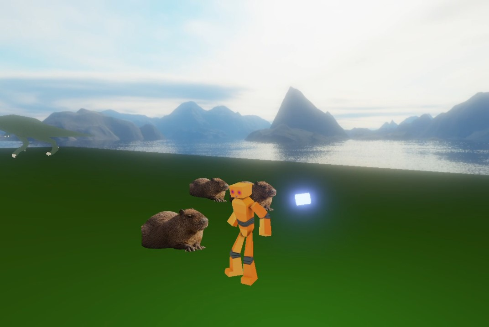
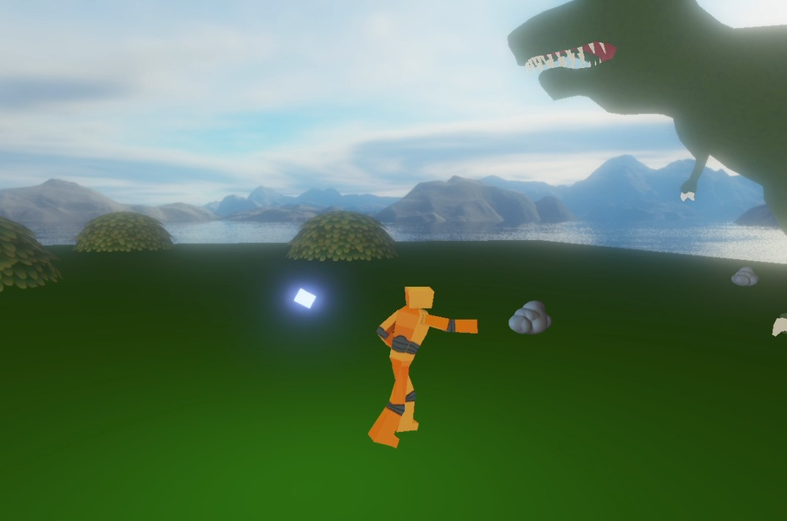
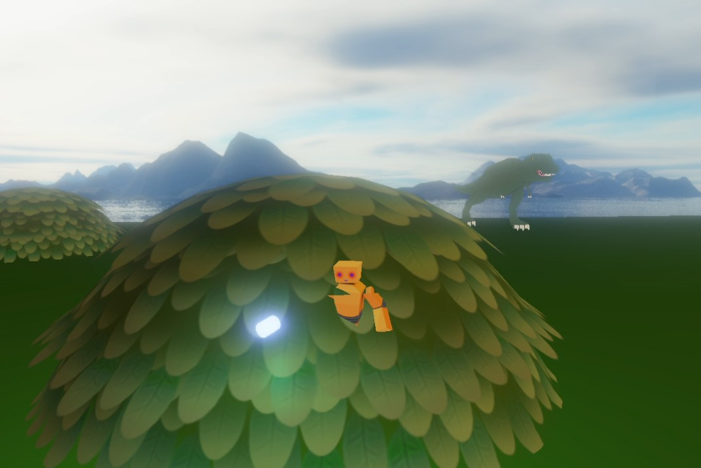
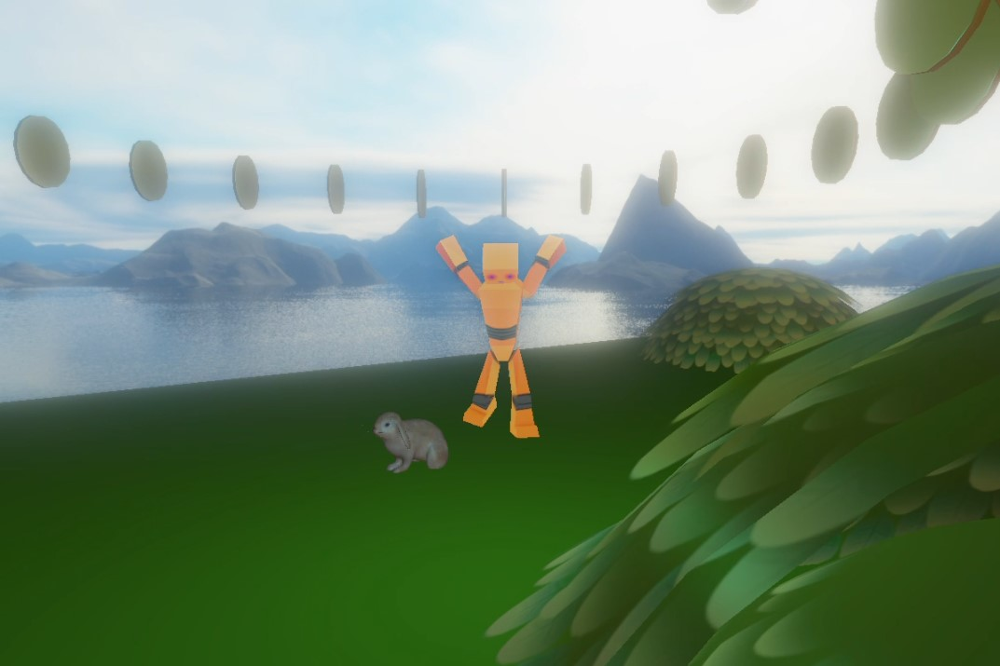
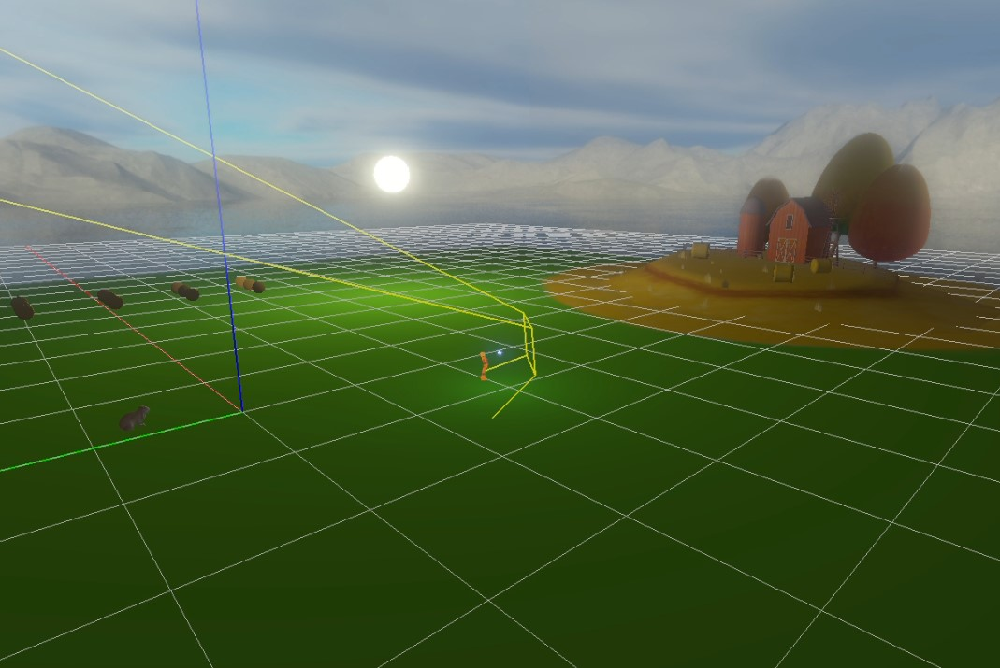

Desarrollé un motor 3D para crear pequeños juegos de exploración en tercera persona. Su demo, *CatchGame*, permite recorrer una granja con un robot animado, perseguir a un conejo y recoger monedas.

[Ver el código fuente en GitHub](https://github.com/sebastianolmos/JourneyEngine)

## Contexto y aporte personal

Construí Journey Engine en 2022 para el curso Arquitectura de Motores de Juegos (CC5512) de la Universidad de Chile. Lo desarrollé a lo largo del semestre, en hitos incrementales. Quería crear una herramienta que me permitiera practicar el diseño de pequeños mundos 3D de exploración, con juegos como *A Short Hike* y *Lonely Mountains: Downhill* como referentes.

Implementé Journey Engine como una biblioteca estática y construí CatchGame como una aplicación que la utiliza. LearnOpenGL fue mi principal referencia técnica, en particular para la animación esquelética y el bloom. Integré esas técnicas al ciclo de la escena, añadí el registro de clips de animación por nombre y conecté su reproducción con el movimiento del personaje. También implementé la jerarquía de entidades y la lógica de la demo.

## Del mando al personaje en pantalla

Al mover el stick izquierdo, *CatchGame* recibe los ejes del mando a través de dos acciones registradas por nombre. En cada cuadro, el motor lee la entrada y actualiza el personaje. La posición se calcula con el tiempo transcurrido desde el cuadro anterior y la dirección del movimiento se ajusta a la orientación de la cámara. Al superar un umbral de velocidad, el juego activa la animación de carrera.

**Una entidad para el control y otra para la malla.** La entidad principal guarda la posición del jugador y ejecuta la lógica de movimiento. Bob, el robot que se ve en pantalla, es una entidad hija con un componente de malla esquelética. Al recorrer la escena, el motor combina la transformación de la entidad principal con la de Bob. Así, el modelo acompaña al personaje y conserva su propia escala y orientación local.

**La CPU calcula la pose y la GPU deforma la malla.** Integré la animación esquelética al ciclo de la escena y añadí el registro de clips por nombre. Con Assimp, el motor lee del mismo archivo FBX la malla, los pesos de los huesos y los clips. En cada cuadro, la CPU interpola la posición y la escala de los huesos, interpola sus rotaciones con cuaterniones y calcula las matrices de la pose siguiendo la jerarquía del esqueleto. El shader de vértices usa esas matrices para calcular la posición de cada vértice, ponderando la influencia de hasta cuatro huesos.

## Tecnologías

C++20, OpenGL 3.3 y GLSL para gráficos, GLFW para ventanas y entrada, GLM para matemáticas, Assimp para importar modelos y animaciones, OpenAL Soft para audio y CMake para compilar.

## Resultado y cómo comprobarlo

El hito final reunió los sistemas del motor en un minijuego de exploración con cámara de seguimiento, un personaje animado y una mecánica de recolección. Cuando Bob alcanza al conejo, este se detiene y dispersa monedas que se recogen por proximidad. La escena también incorpora posprocesado HDR y *bloom* para producir un halo alrededor de las zonas más brillantes.

Para probar el recorrido con una compilación de Windows, ejecuta `CatchGame.exe` desde `build/games/Release` con un mando conectado. Mueve el stick izquierdo y luego suéltalo. Deberías ver que la cámara sigue a Bob y que el personaje cambia de reposo a carrera y vuelve a reposo al detenerse. El repositorio incluye las instrucciones de preparación.

## Alcance

La demo construye su escenario en código al arrancar. Las sombras en cascada y los diálogos con personajes quedaron como mejoras futuras.

## Capturas

