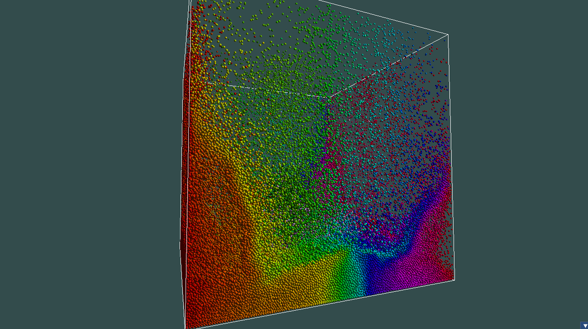
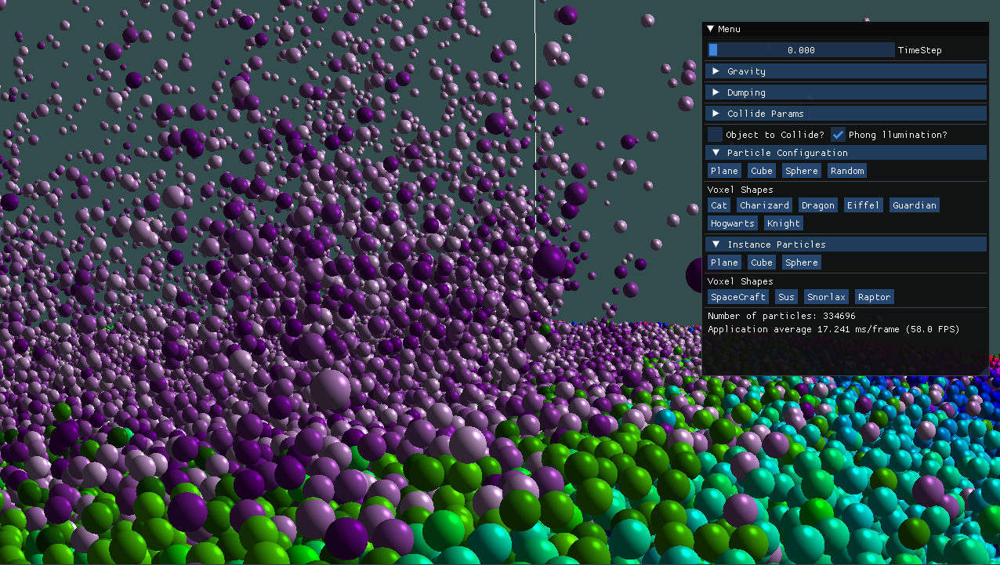
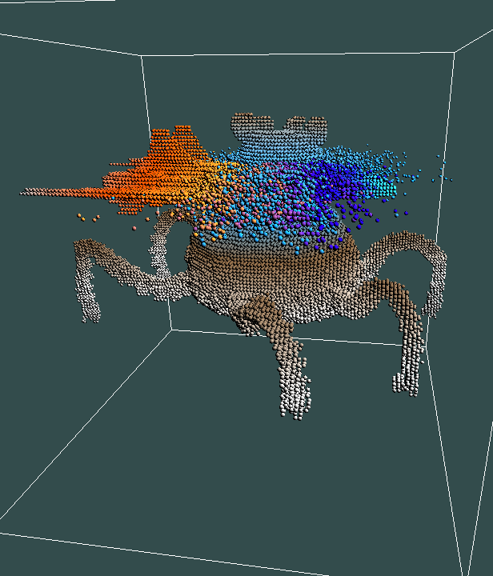
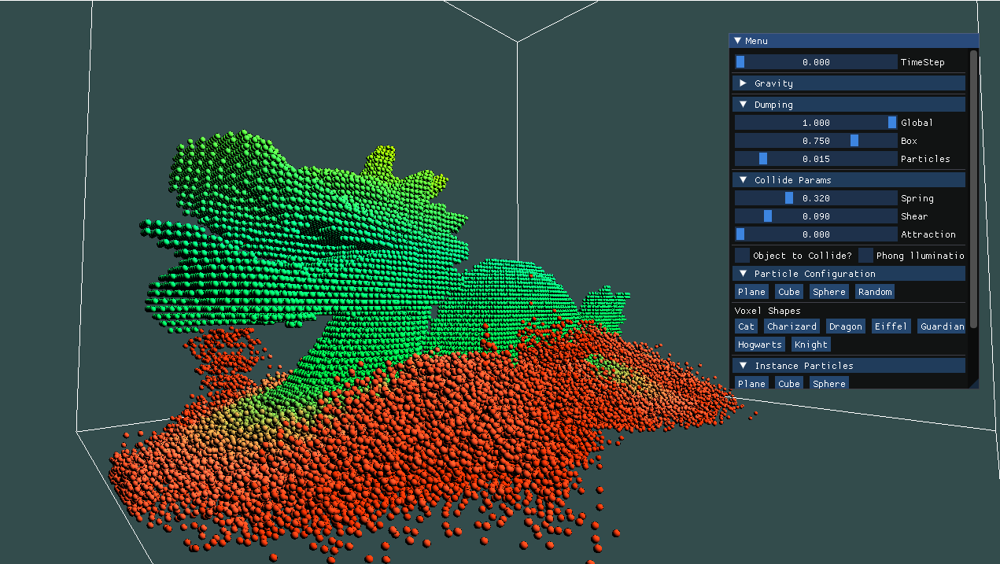

I built a simulator of spherical particles that fall, bounce, and collide inside a 3D box. The application computes collisions on the GPU and lets you change gravity, damping, and the initial configuration while viewing the scene.

[View the source code and run instructions on GitHub](https://github.com/sebastianolmos/particle_system)

## Context and personal contribution

I developed this project in 2021 for the **CC7515-1 GPU Computing** course at the University of Chile. My interest in computer graphics led me to explore how to simulate many particles interactively. The challenge was detecting contacts at each step without checking every possible pair, a search whose cost grows quadratically with the number of particles.

I used Simon Green's work and the CUDA Toolkit particle sample as a starting point. I adapted that approach into a desktop application, added controls for changing the simulation in real time, and incorporated a voxel model reader. This let me use shapes such as a cat or the Eiffel Tower as initial simulation configurations. [Particle Simulation using CUDA, Simon Green, NVIDIA](https://developer.download.nvidia.com/assets/cuda/files/particles.pdf)

## How it works

When you choose **Cat** from the menu, the application creates one particle for each voxel in the model. It converts the discrete coordinates into positions inside the box and assigns each particle an initial velocity of zero. At each step, CUDA first updates velocities with gravity and damping, then advances positions using the Euler method and corrects bounces against the walls.

**Cell-based collision search.** The grid divides the box into cells whose side length equals a particle's diameter. I moved from a prototype with four reserved slots per cell to a version that sorts particles by cell ID with Thrust. Each cell is represented by a contiguous range, removing that fixed capacity. One CUDA thread per particle traverses its cell and the 26 neighboring cells, using the distance between centers to confirm each contact. If two spheres overlap, the response combines restitution, damping, and a tangential term that changes velocity for the next step. The amount of work still depends on how many particles accumulate in those cells.

**A shared buffer for simulation and rendering.** CUDA updates positions in an OpenGL buffer that is reused when drawing the frame. This lets rendering read the positions directly on the GPU at each step. OpenGL draws one point per particle, and a shader gives each point a spherical appearance through shading.

## Technologies

C++, CUDA and Thrust for simulation, OpenGL 3.3 and GLSL for rendering, GLFW and Dear ImGui for the window and controls.

## Outcome and how to try it

The simulation uses a sorted grid for neighbor-based collision detection and lets you explore its behavior in an interactive 3D scene. In the project's third iteration, I recorded **120 FPS with 524,288 particles** on an **NVIDIA GeForce GTX 1060**. The published version starts with 262,144 particles, reserves space for 524,288, and limits the simulation and rendering loop to about 60 frames per second.

To try it on Windows with a CUDA-compatible GPU, follow the README instructions and choose **Particle Configuration → Cat** with the default gravity. The menu should show **60,391 particles**, and the figure should fall apart when it hits the bottom of the box. [The repository includes the code and run instructions](https://github.com/sebastianolmos/particle_system).

## Screenshots

