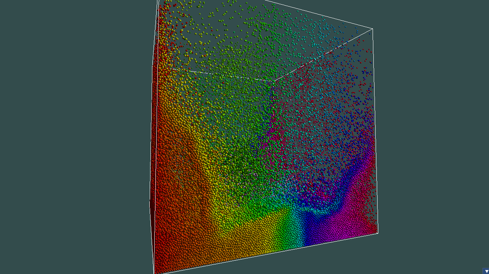
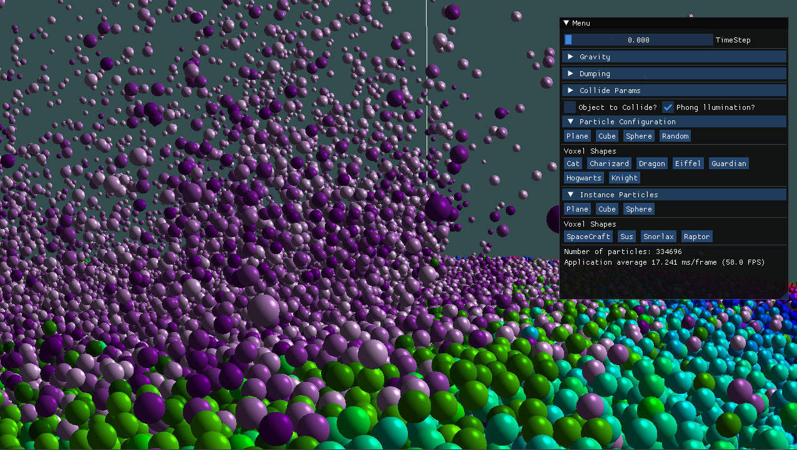
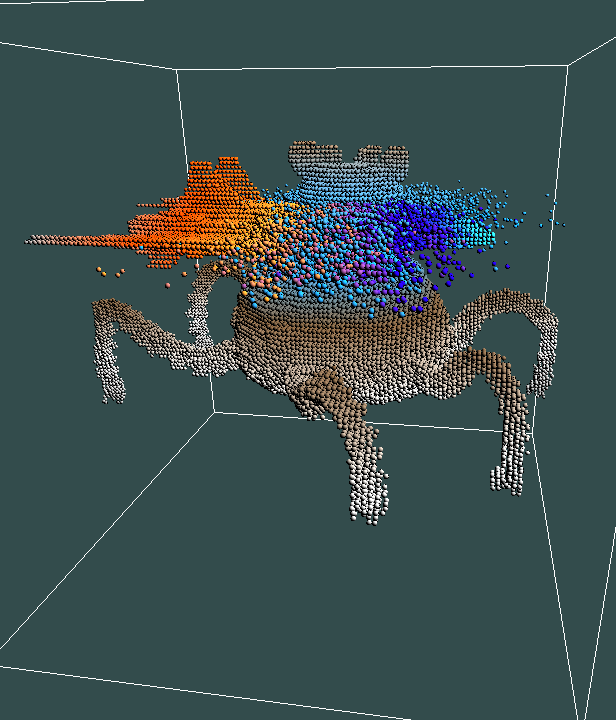
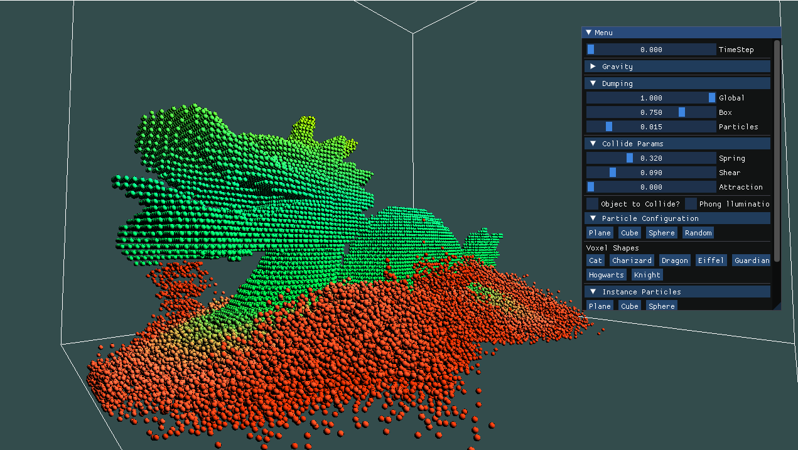

Construí un simulador de partículas esféricas que caen, rebotan y chocan entre sí dentro de una caja tridimensional. La aplicación calcula las colisiones en la GPU y permite cambiar la gravedad, el amortiguamiento y la configuración inicial mientras se visualiza la escena.

[Ver código e instrucciones de ejecución en GitHub](https://github.com/sebastianolmos/particle_system)

## Contexto y aporte personal

Desarrollé este proyecto en 2021 para el curso **CC7515-1 Computación en GPU** de la Universidad de Chile. Mi interés por la computación gráfica me llevó a explorar cómo simular muchas partículas de forma interactiva. El desafío era detectar contactos en cada paso sin recorrer todos los pares posibles, una búsqueda cuyo costo crece cuadráticamente con el número de partículas.

Tomé como punto de partida el trabajo de Simon Green y el ejemplo de partículas del CUDA Toolkit. Adapté ese enfoque a una aplicación de escritorio, integré controles para modificar la simulación en vivo e incorporé un lector de modelos voxelizados. Así pude usar figuras como un gato o la Torre Eiffel como configuraciones iniciales de la simulación. [Particle Simulation using CUDA, Simon Green, NVIDIA](https://developer.download.nvidia.com/assets/cuda/files/particles.pdf)

## Cómo funciona

Al elegir **Cat** en el menú, la aplicación genera una partícula por cada vóxel del modelo. Convierte sus coordenadas discretas en posiciones dentro de la caja y les asigna velocidad inicial cero. En cada paso, CUDA actualiza primero las velocidades con gravedad y amortiguamiento, luego avanza las posiciones mediante el método de Euler y corrige los rebotes contra las paredes.

**Búsqueda de colisiones por celdas.** La cuadrícula divide la caja en celdas cuyo lado mide un diámetro de partícula. Pasé de un prototipo con cuatro lugares reservados por celda a una versión que ordena las partículas por el identificador de su celda con Thrust. Cada celda queda representada por un rango contiguo, lo que elimina ese cupo fijo. Un hilo de CUDA por partícula recorre su celda y las 26 vecinas, y usa la distancia entre centros para confirmar cada contacto. Si dos esferas se solapan, la respuesta combina restitución, amortiguamiento y un término tangencial que modifica la velocidad para el paso siguiente. El trabajo sigue dependiendo de cuántas partículas se concentren en esas celdas.

**Un búfer compartido para simular y dibujar.** CUDA actualiza las posiciones en un búfer de OpenGL que se vuelve a usar al dibujar el cuadro. Así, el renderizado puede leer las posiciones directamente en la GPU en cada paso. OpenGL dibuja un punto por partícula y un shader le da apariencia esférica mediante sombreado.

## Tecnologías

C++, CUDA y Thrust para la simulación, OpenGL 3.3 y GLSL para el renderizado, GLFW y Dear ImGui para la ventana y los controles.

## Resultado y cómo comprobarlo

La simulación usa una cuadrícula ordenada para detectar colisiones por vecindad y permite explorar su comportamiento en una escena 3D interactiva. En la tercera iteración del proyecto registré **120 FPS con 524.288 partículas** en una **NVIDIA GeForce GTX 1060**. La versión publicada inicia con 262.144 partículas, reserva espacio para 524.288 y limita el ciclo de simulación y dibujo a unos 60 cuadros por segundo.

Para probarla en Windows con una GPU compatible con CUDA, sigue las instrucciones del README y elige **Particle Configuration → Cat** con la gravedad por defecto. El menú debería mostrar **60.391 partículas** y la figura debería caer y desarmarse al chocar con el fondo de la caja. [El repositorio incluye el código y las instrucciones de ejecución](https://github.com/sebastianolmos/particle_system).

## Capturas

