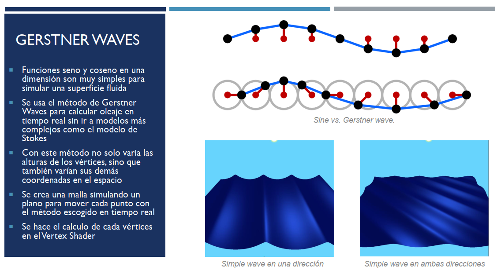
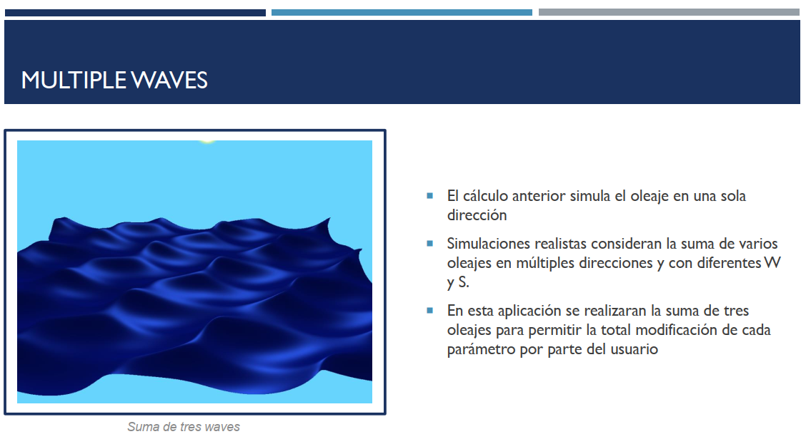
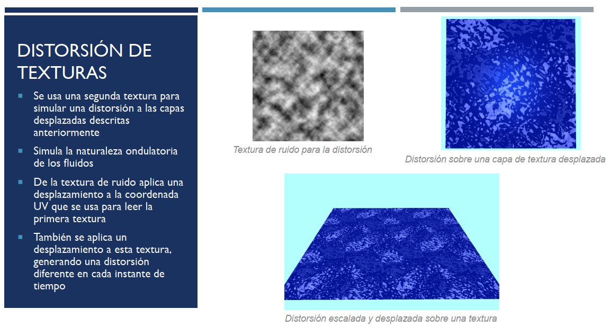
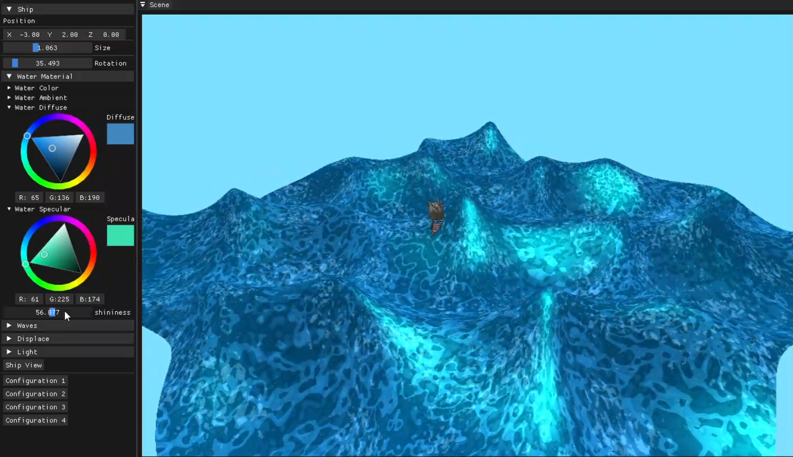
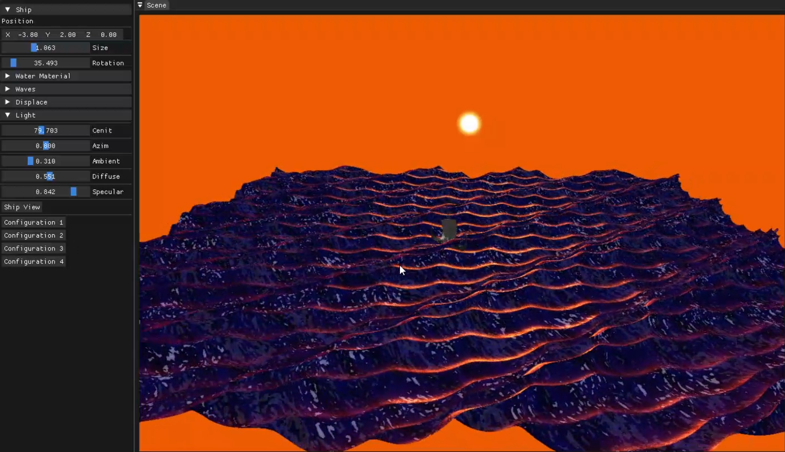
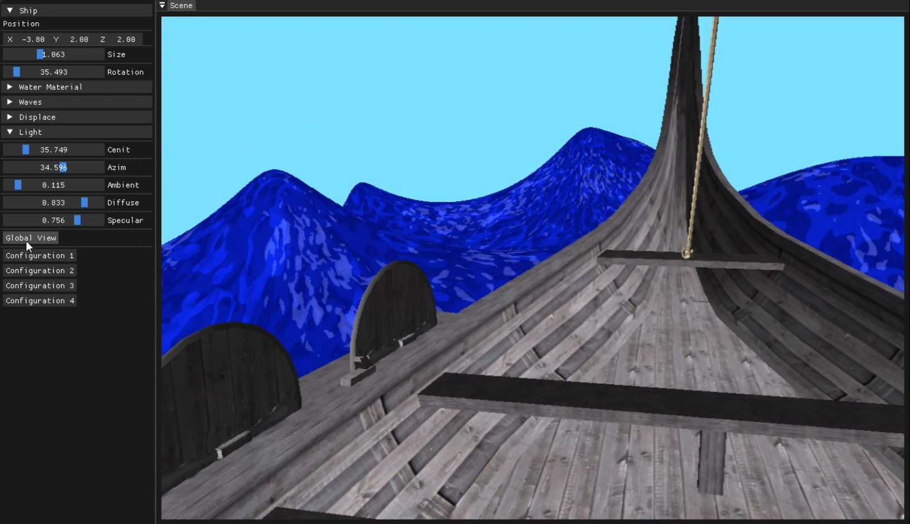

I built a 3D scene that animates a water or lava surface in real time. You can adjust the waves while the scene runs and watch a ship move, either from an overview or an onboard camera.

[View the source code on GitHub](https://github.com/sebastianolmos/sea_anim)

### Context and contribution

I developed **Sea Animation** in 2021 for the shader assignment in the **CC7515-1 GPU Computing** course at the University of Chile. The challenge was to animate an interactive fluid surface and add a 3D object to the scene.

To implement the waves, I used *Waves*, Jasper Flick's Catlike Coding tutorial on combining Gerstner waves, as a reference. I adapted the calculation to GLSL to deform the surface on the GPU and also implemented it in C++ to move a Viking ship with the same waves. I added animated textures, a panel for adjusting the scene in real time, and a camera that follows the ship's movement.

[Waves — Jasper Flick, Catlike Coding](https://catlikecoding.com/unity/tutorials/flow/waves/)

### How it works

**The surface and ship share the same wave model.** At startup, the application loads a flat mesh of 512 × 512 vertices onto the GPU. When you adjust a *Waves* control, C++ sends the new parameters and time to the vertex shader on the next frame. The shader adds the displacement of three Gerstner waves at each vertex. The waves move points both vertically and horizontally, and the shader estimates normals so lighting follows the surface. The base mesh is loaded only once.

To move the ship, the CPU evaluates the same three waves with the same parameters and time at a single point on the surface. The sum of those displacements determines the model's position. Its tilt is calculated separately from the tangent of the third wave, and the onboard camera follows that transform as well.

**Visual detail is calculated separately.** The fragment shader combines directional lighting with three animated texture layers. A second texture distorts the coordinates used to sample those layers. This lets foam patterns or lava streaks move across the surface without adding vertices to the mesh.

### Technologies

C++ and GLSL with OpenGL 4.5 Core, GLFW and GLAD for the window and OpenGL access, GLM for transforms, Dear ImGui for controls, Assimp for importing the ship, and stb_image for loading textures.

### Outcome and how to try it

The scene includes four configurations that show the range of the system: sea with large waves, sea with small waves, sunset, and lava. You can keep adjusting all of them from the panel while the animation runs.

To try the connection between the waves and the ship, run the solution on Windows with the x64 configuration specified in the README. In the overview, enable **Configuration 1** and set **Waves → Third Wave → Steepness** to zero. You should see the surface relief change and the wave-driven tilt disappear, while the model continues to rise and fall with the other two waves.

### Scope

The ship's movement is a visual approximation based on one point on the surface. The application calculates its position and tilt from the waves while the surface evolves independently.

### Screenshots

