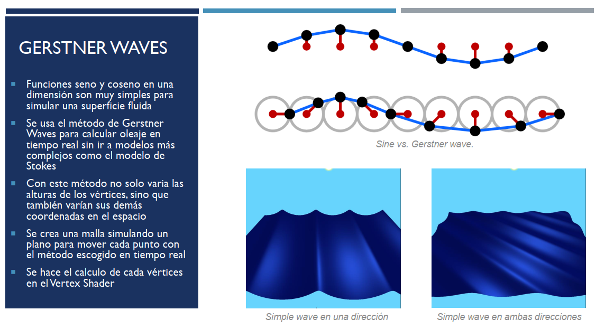
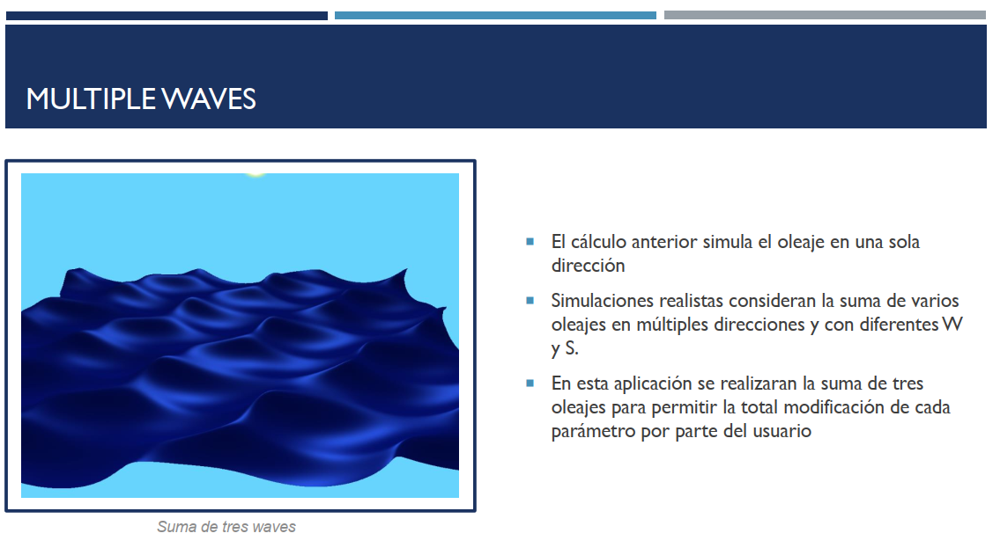
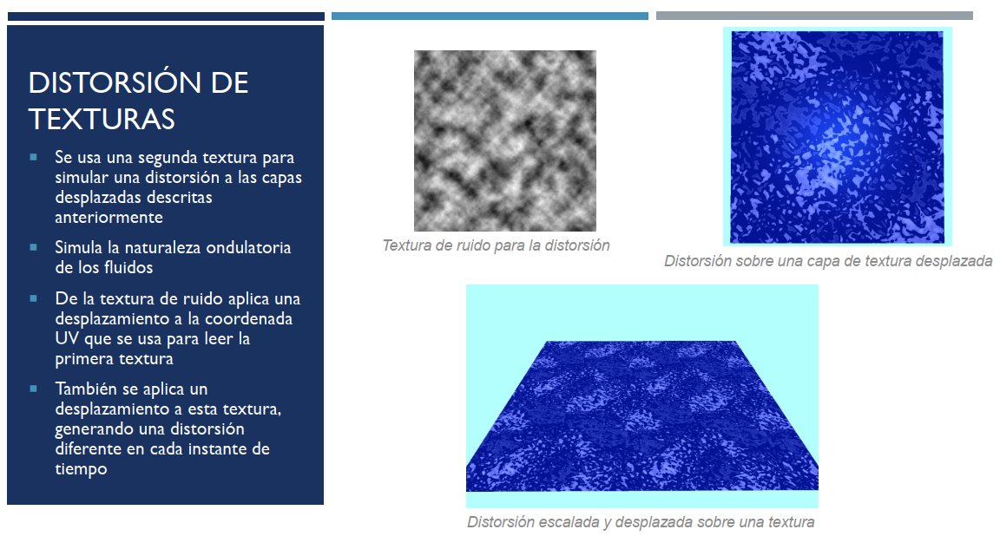
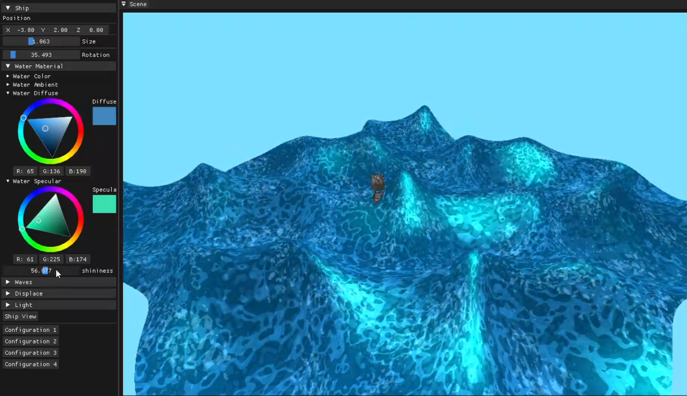
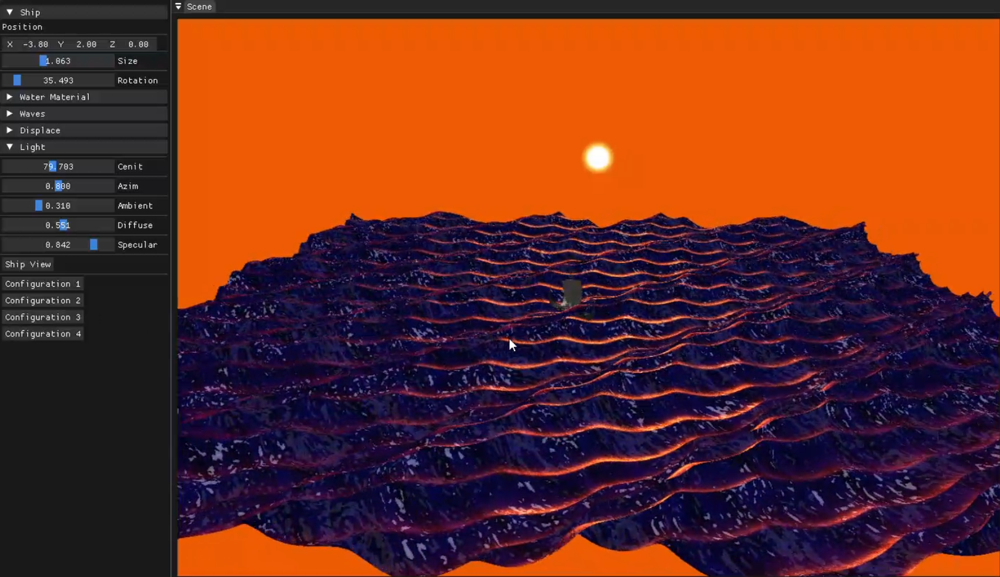
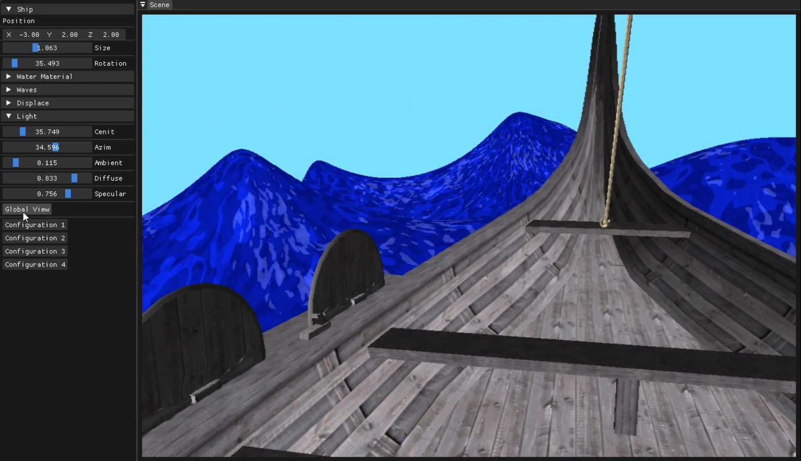

Construí una escena 3D que anima una superficie de agua o lava en tiempo real. Puedes modificar el oleaje mientras la escena está en marcha y observar cómo se mueve un barco, tanto desde una vista general como desde una cámara a bordo.

[Ver el código en GitHub](https://github.com/sebastianolmos/sea_anim)

### Contexto y aporte

Desarrollé **Sea Animation** en 2021 para la tarea de shaders del curso **CC7515-1 Computación en GPU** de la Universidad de Chile. El desafío era animar una superficie fluida interactiva e incorporar un objeto 3D a la escena.

Para implementar el oleaje tomé como referencia *Waves*, el tutorial de Jasper Flick en Catlike Coding sobre la composición de ondas de Gerstner. Adapté el cálculo a GLSL para deformar la superficie en la GPU y lo implementé también en C++ para mover un barco vikingo con el mismo oleaje. Añadí texturas animadas, un panel para ajustar la escena en tiempo real y una cámara que acompaña el movimiento del barco.

[Waves — Jasper Flick, Catlike Coding](https://catlikecoding.com/unity/tutorials/flow/waves/)

### Cómo funciona

**Una misma descripción del oleaje para la superficie y el barco.** Al iniciar, la aplicación carga en la GPU una malla plana de 512 × 512 vértices. Cuando ajustas un control de *Waves*, C++ envía los nuevos parámetros y el tiempo al shader de vértices en el siguiente fotograma. El shader suma el desplazamiento de tres ondas de Gerstner en cada vértice. Las ondas mueven los puntos tanto en altura como horizontalmente, y el shader estima las normales para que la iluminación acompañe el relieve. La malla base se carga una sola vez.

Para mover el barco, la CPU evalúa las mismas tres ondas con los mismos parámetros y el mismo tiempo, en un solo punto de la superficie. La suma de esos desplazamientos determina la posición del modelo. Su inclinación se calcula aparte, a partir de la tangente de la tercera onda, y la cámara a bordo también sigue esa transformación.

**El detalle visual se calcula por separado.** El shader de fragmentos combina iluminación direccional con tres capas de textura animadas. Una segunda textura distorsiona las coordenadas con las que se muestrean esas capas. Esto permite que los patrones de espuma o las vetas de lava cambien sobre la superficie sin añadir vértices a la malla.

### Tecnologías

C++ y GLSL con OpenGL 4.5 Core, GLFW y GLAD para la ventana y el acceso a OpenGL, GLM para las transformaciones, Dear ImGui para los controles, Assimp para importar el barco y stb_image para cargar texturas.

### Resultado y cómo probarlo

La escena incluye cuatro configuraciones que muestran el rango del sistema: mar con olas altas, mar con olas pequeñas, atardecer y lava. Todas se pueden seguir ajustando desde el panel mientras corre la animación.

Para probar la conexión entre el oleaje y el barco, ejecuta la solución en Windows con la configuración x64 indicada en el README. En la vista general, activa **Configuration 1** y lleva a cero el control **Waves → Third Wave → Steepness**. Deberías ver que cambia el relieve y desaparece la inclinación del barco causada por el oleaje, mientras el modelo sigue subiendo y bajando con las otras dos ondas.

### Alcance

El movimiento del barco es una aproximación visual basada en un punto de la superficie. La aplicación calcula su posición e inclinación a partir del oleaje y la superficie evoluciona de forma independiente.

### Capturas

