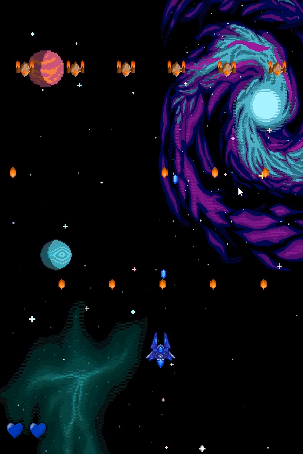
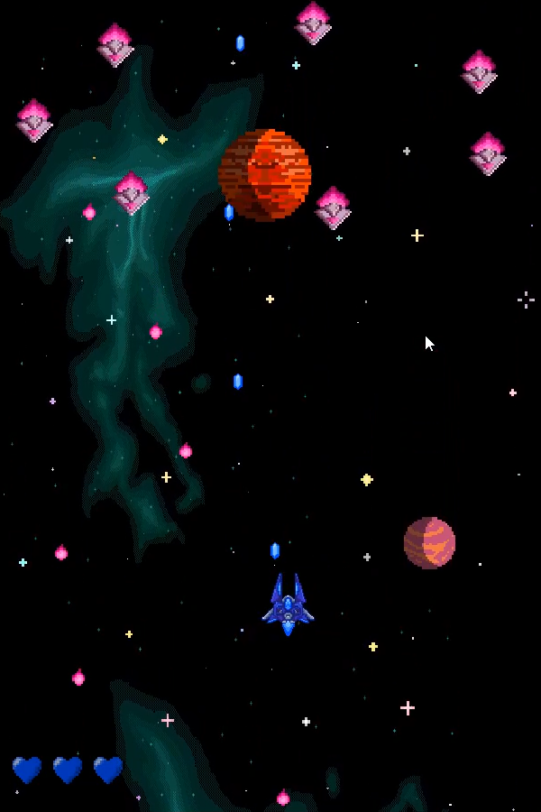
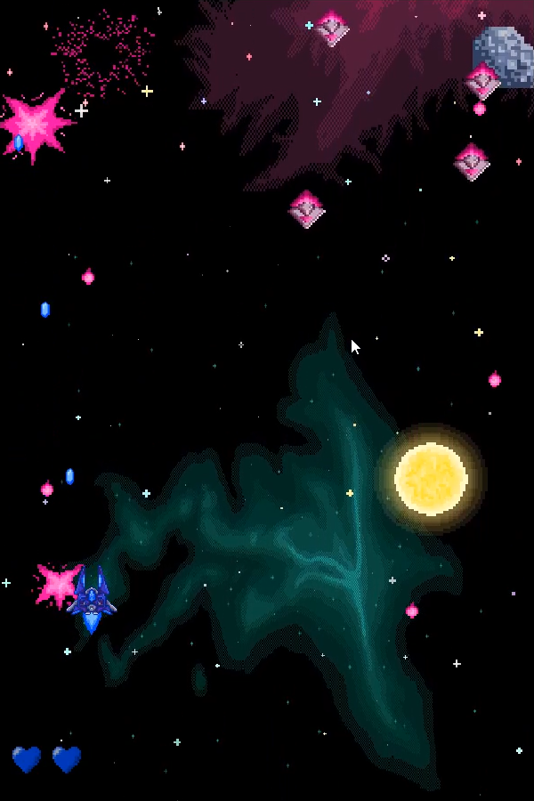
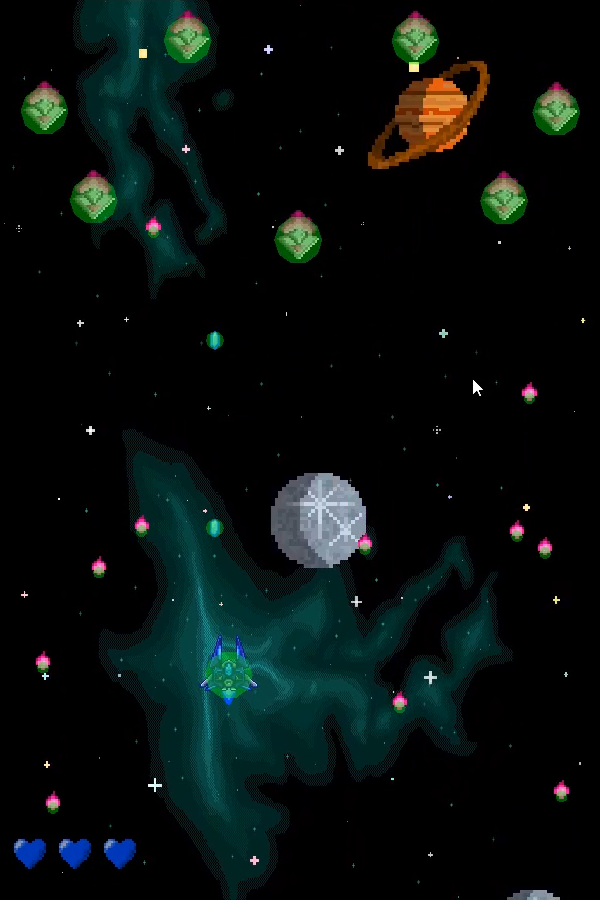

I developed a desktop game where you pilot a ship, dodge shots, and eliminate waves of enemies before losing your three lives. The game takes place against a background of stars, nebulae, and planets moving at different speeds.

[View the source code on GitHub](https://github.com/sebastianolmos/space_war) · [Watch the sample video](https://youtu.be/xSro4OZhk54)

## Context and personal contribution

I developed Space War for the first assignment in **Modeling and Computer Graphics for Engineers (CC3501)** at the University of Chile in fall 2020. The assignment called for an OpenGL 2D game with a moving background, shots, and enemies that appeared gradually. The technical challenge was coordinating controls, movement, collisions, and animations within one game loop.

I created the sprites and background illustrations, including the stars, nebulae, and planets. Building on the graphics modules provided by the course, I implemented the game loop, enemy wave movement and firing patterns, and hit detection. I reused code from an earlier exercise to animate the ships and explosions.

## How it works

At startup, the program loads the sprite sheets and organizes the elements in a scene graph. During play, holding the spacebar fires projectiles upward at set intervals. Each frame, the game checks whether a projectile overlaps an enemy. When it detects a hit, it removes the projectile and starts the enemy's explosion. The enemy ship leaves the graph when its animation ends. In a three-enemy game, the final explosion starts the victory animation, and the player's ship exits off the top of the screen.

**Appearance and collision in the same graph.** Each ship and projectile has a node with two children: one for its appearance and one for its collision area. Both follow the object's movement. To detect a hit, the game compares the distance between the centers with the sum of their radii and adjusts the calculation for the window's aspect ratio. Pressing **Tab** triggers a second traversal of the graph that draws these areas as translucent circles, showing which parts of each sprite count for a hit.

**Continuous background with parallax.** Nebulae move more slowly than stars, while planets move faster than both layers. When an element exits at the bottom, the game adds another at the top with attributes chosen randomly from the available sprites. The speed differences create a sense of depth, and replacing elements keeps the scenery moving with compositions that vary throughout the game.

## Technologies

Python, OpenGL through PyOpenGL, GLSL for shaders, GLFW for the window and keyboard input, NumPy for transforms, and Pillow for loading images.

## Outcome and how to try it

The project brings together three enemy patterns, a continuously scrolling background, and animated victory and defeat endings. On defeat, the scene gradually transitions to grayscale. The assignment report includes screenshots of the patterns, collision areas, and both ending screens.

For a short game, run `python space-war.py 3` from `code/` on Windows with the README dependencies installed. Move with **W, A, S, and D**, fire with **Space**, and press **Tab** to see circles over the ships and projectiles. After destroying all three ships and the last explosion finishes, **You Win!** should appear.

## Limitation

The wave counter has an edge case. When six enemies remain to spawn, random selection can generate seven and trigger victory while an enemy ship is still on screen.

## Screenshots

