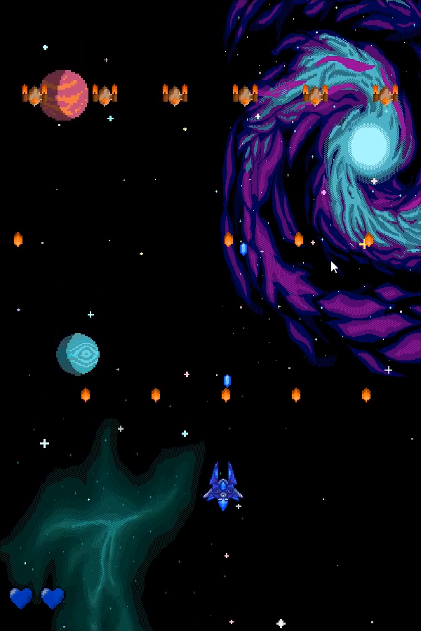
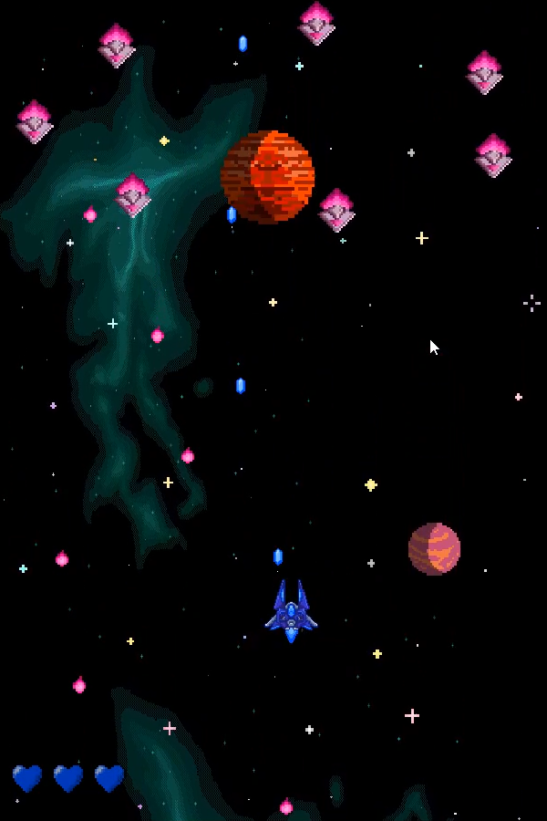
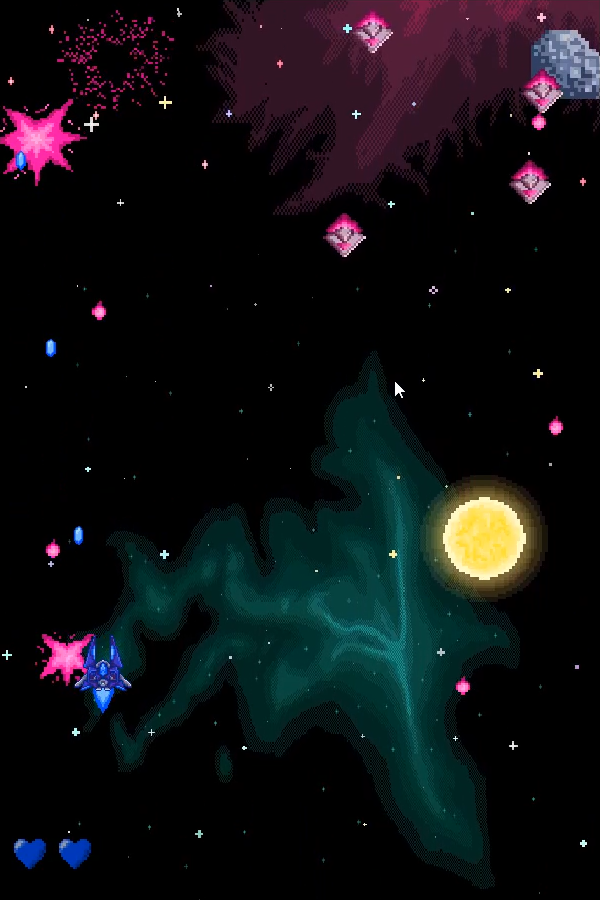
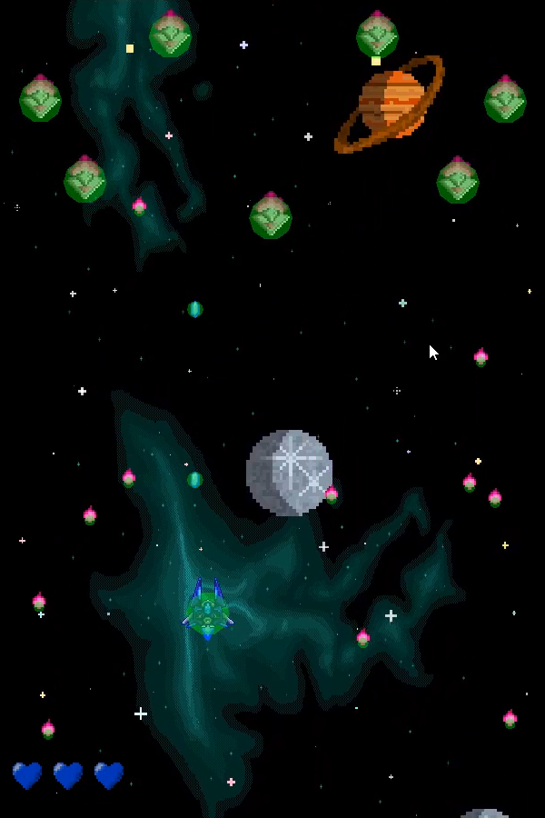

Desarrollé un juego de escritorio en el que pilotas una nave, esquivas disparos y eliminas oleadas enemigas antes de perder tus tres vidas. La partida transcurre sobre un fondo de estrellas, nebulosas y planetas que se desplazan a distintas velocidades.

[Ver el código en GitHub](https://github.com/sebastianolmos/space_war) · [Video de muestra](https://youtu.be/xSro4OZhk54)

## Contexto y aporte personal

Desarrollé Space War para la primera tarea de **Modelación y Computación Gráfica para Ingenieros (CC3501)** de la Universidad de Chile, en otoño de 2020. El encargo pedía construir con OpenGL un juego 2D con un fondo en movimiento, disparos y enemigos que aparecieran gradualmente. El desafío técnico era coordinar los controles, el movimiento, las colisiones y las animaciones dentro de un mismo ciclo de juego.

Creé los sprites y las ilustraciones del fondo, incluidas las estrellas, las nebulosas y los planetas. Sobre los módulos gráficos entregados por el curso, implementé el ciclo de juego, los patrones de movimiento y disparo de las oleadas y la detección de impactos. Para animar las naves y las explosiones, reutilicé código que había escrito en un ejercicio anterior.

## Cómo funciona

Al iniciar, el programa carga las hojas de sprites y organiza los elementos en un grafo de escena. Durante la partida, mantener presionada la barra espaciadora dispara proyectiles hacia arriba a intervalos de recarga. En cada cuadro, el juego comprueba si un proyectil se superpone con un enemigo. Cuando detecta un impacto, retira el proyectil e inicia la explosión del enemigo. La nave enemiga sale del grafo cuando termina su animación. En una partida de tres enemigos, la última explosión da paso a la animación de victoria y la nave del jugador sale por arriba.

**Apariencia y colisión en el mismo grafo.** Cada nave y proyectil tiene un nodo con dos hijos, uno para su apariencia y otro para su área de colisión. Ambos acompañan el movimiento del objeto. Para detectar un impacto, el juego compara la distancia entre los centros con la suma de los radios y corrige el cálculo según la proporción de la ventana. La tecla **Tab** activa un segundo recorrido del grafo que dibuja esas áreas como círculos translúcidos, de modo que se puede ver qué parte de cada sprite cuenta para un impacto.

**Fondo continuo con paralaje.** Las nebulosas se desplazan más despacio que las estrellas, y los planetas se mueven más rápido que ambas capas. Cuando un elemento sale por abajo, el juego incorpora otro por arriba con atributos elegidos al azar a partir de los sprites disponibles. La diferencia de velocidades da sensación de profundidad y la reposición mantiene el paisaje en movimiento con composiciones que varían durante la partida.

## Tecnologías

Python, OpenGL mediante PyOpenGL, GLSL para los shaders, GLFW para la ventana y el teclado, NumPy para las transformaciones y Pillow para cargar las imágenes.

## Resultado y cómo comprobarlo

La entrega integra tres patrones de enemigos, un fondo con desplazamiento continuo y finales animados de victoria y derrota. En la derrota, la escena pasa progresivamente a escala de grises. El informe de la tarea incluye capturas de los patrones, las áreas de colisión y ambas pantallas finales.

Para una partida corta, ejecuta `python space-war.py 3` desde `code/` en Windows con las dependencias del README instaladas. Muévete con **W, A, S y D**, dispara con **Espacio** y pulsa **Tab** para ver los círculos sobre las naves y los proyectiles. Al destruir las tres naves y terminar la última explosión, debería aparecer **You Win!**.

## Limitación

El conteo de oleadas tiene un caso límite. Si quedan seis enemigos por aparecer, la selección aleatoria puede generar siete y activar la victoria cuando aún queda una nave enemiga en escena.

## Capturas

