I built a generator that turns a distribution of points into a 3D island with elevation, ocean, and lakes. The viewer lets you explore the terrain from different angles and change the island's shape by adjusting the noise seed and scale.

[View the source code on GitHub](https://github.com/sebastianolmos/voronoi_terrain)

## Context and personal contribution

I developed this project in 2021 for the Computational Geometry course (CC5502) at the University of Chile. I wanted to explore how to generate adjustable terrain for games and other graphics applications. The challenge was turning a distribution of points in two dimensions into a surface with coastlines and elevation that could be explored in a browser.

I used Amit Patel's work on polygonal map generation as a reference. My contribution was to transform Javascript-Voronoi's output into a terrain graph, use that graph to classify regions and calculate their elevations, and integrate the result into an interactive viewer. [Polygonal Map Generation for Games](https://www-cs-students.stanford.edu/~amitp/game-programming/polygon-map-generation/)

## How it works

**From points to connected regions.** The generator starts with 50,000 pseudorandom points and builds a Voronoi tessellation, where each cell contains the area closest to one of those points. It applies 15 iterations of Lloyd relaxation: each point moves to the centroid of its cell, then the diagram is recalculated. This produces more evenly sized cells than the initial distribution. The generator then links each cell to its neighbors and records the edges and corners they share. With this structure, traversals can move directly from one region to another.

**From a 2D silhouette to terrain elevation.** Perlin noise, combined with a radial filter and a threshold, creates a land and water mask that favors an island near the center. The generator samples that mask at the cell corners. A depth-first traversal marks one connected water region as ocean; the remaining water cells become lakes. Then a breadth-first traversal starts at zero elevation for coastal cells and adds an increment as it moves into land cells. Corner elevations are calculated by averaging the elevations of the cells that share each corner. Finally, each cell is divided into triangles connecting its center to its perimeter, forming the mesh rendered by Three.js.

## Technologies

JavaScript, HTML, and CSS · Three.js and WebGL for the viewer · Javascript-Voronoi, NoiseJS, and seedrandom for generation · dat.GUI for controls.

## Outcome and how to try it

The prototype generates an elevated island over a tessellation of 50,000 cells. When you change the noise parameters, it recalculates the land and water distribution and elevations over the same tessellation.

To try it, serve the repository over HTTP and open `index.html`. Rotate the camera to inspect the terrain. Then change `seed` and `scale` and press **Refresh** to see the island outline change. In `demoNoise.html`, you can inspect the intermediate 2D step. Lowering **Radius** reduces the white area representing land.

## Scope

Elevation follows a rule based on cell connectivity and proximity to the coast. Rivers, humidity, and biomes remained possible extensions.

## Screenshots

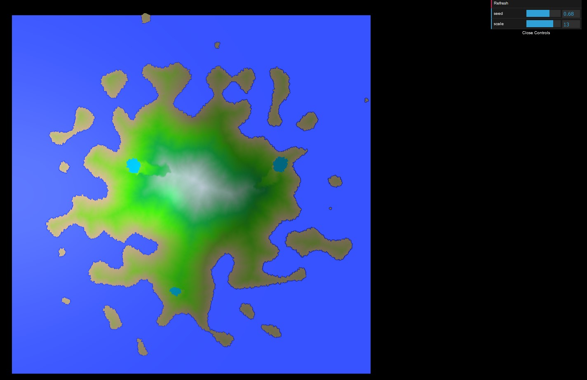

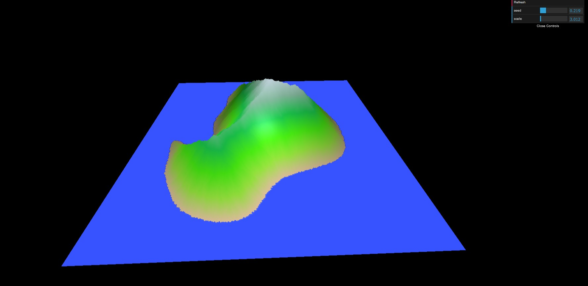

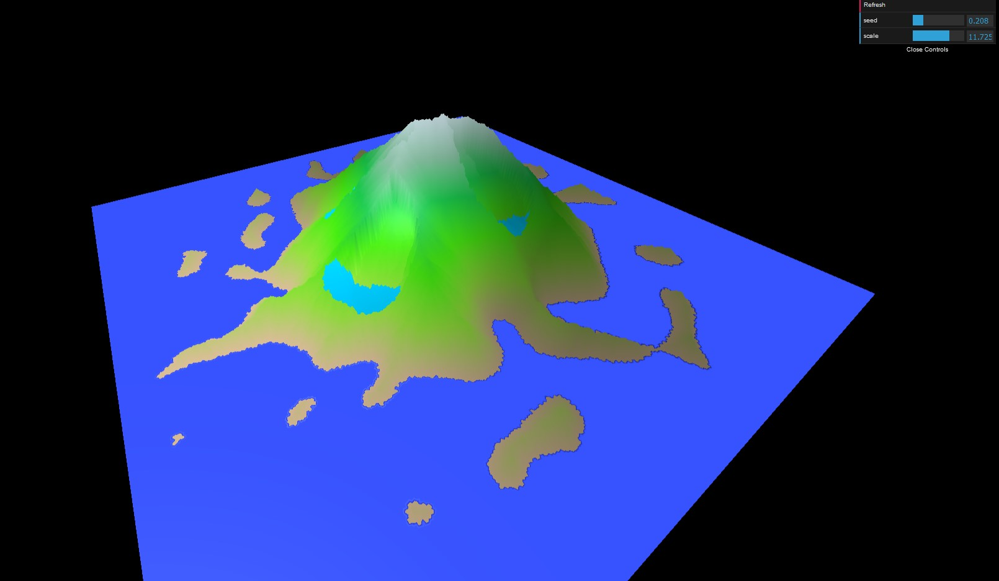

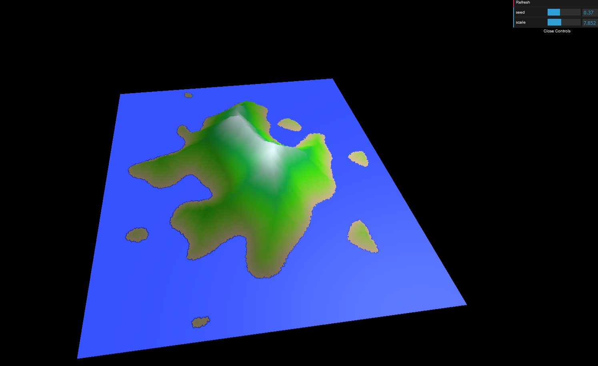

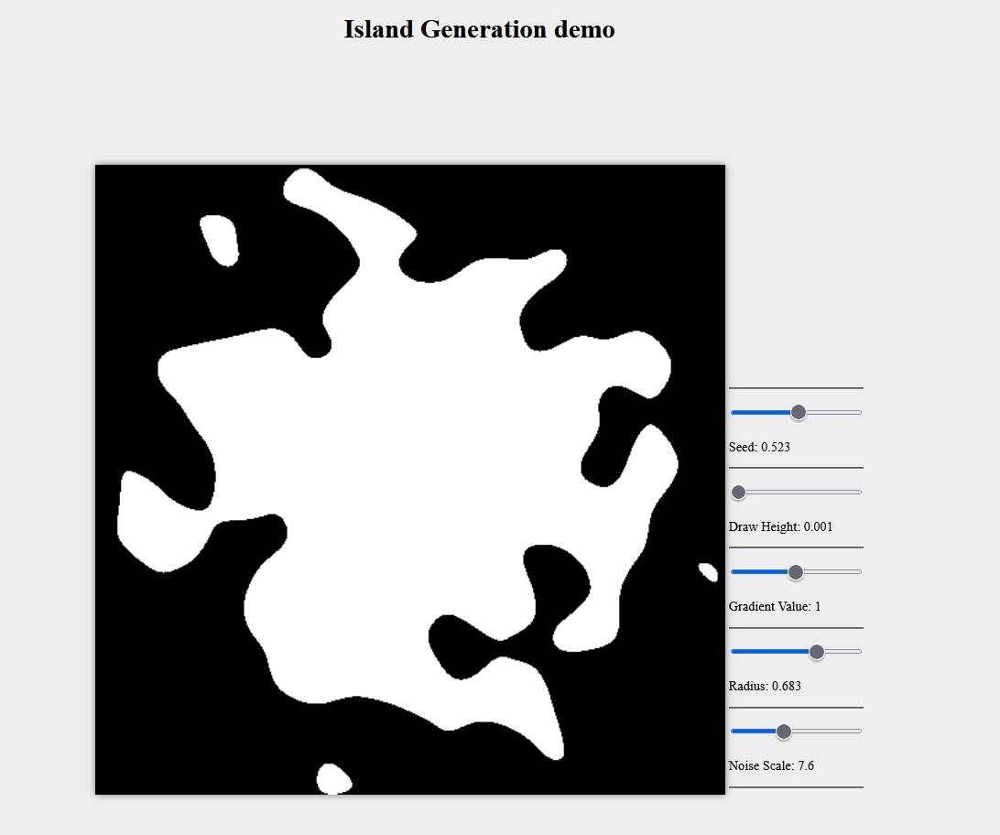

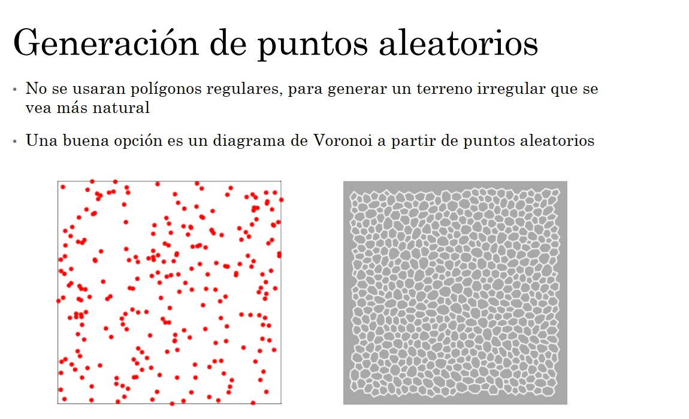

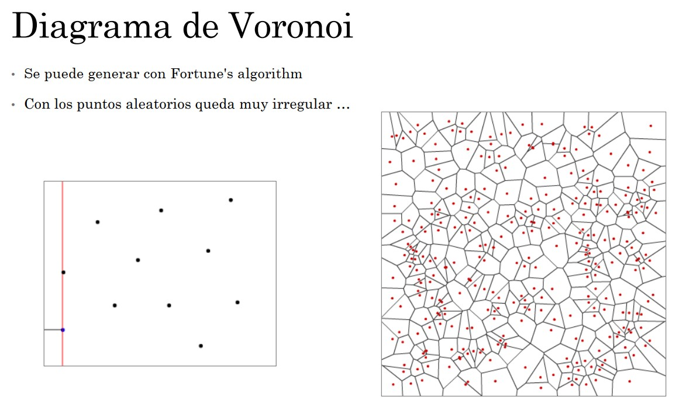

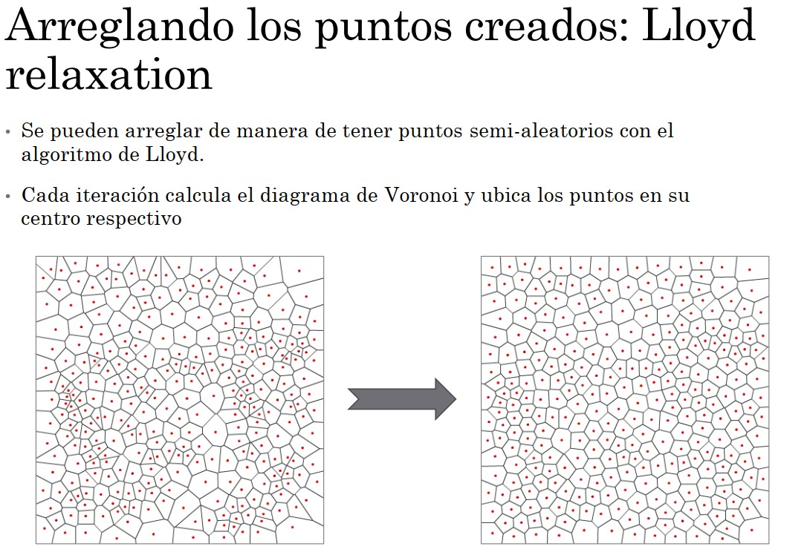

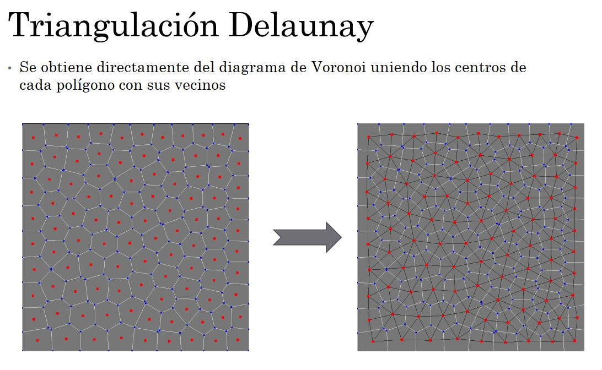

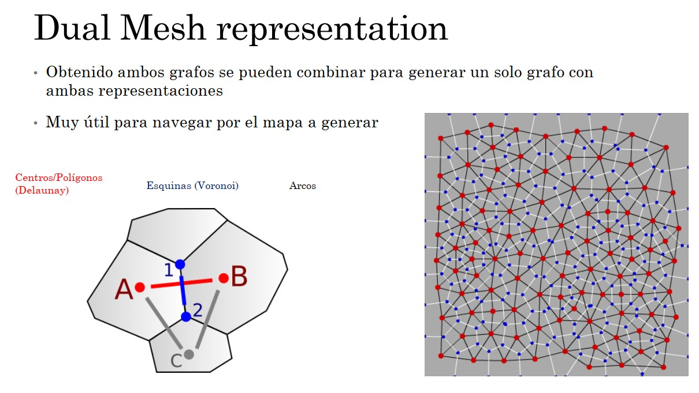

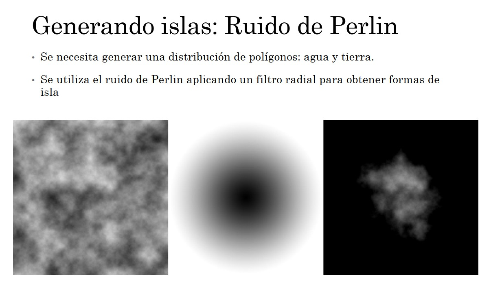

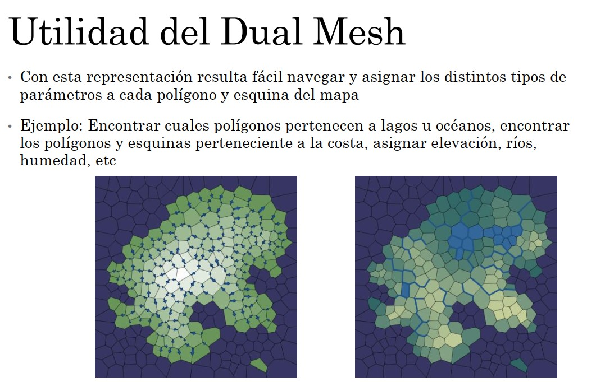
