Construí un generador que transforma una distribución de puntos en una isla 3D con relieve, océano y lagos. El visor permite explorar el terreno desde distintos ángulos y cambiar la forma de la isla ajustando la semilla y la escala del ruido.

[Ver el código fuente en GitHub](https://github.com/sebastianolmos/voronoi_terrain)

## Contexto y aporte personal

Desarrollé el proyecto en 2021 para el curso CC5502 Geometría Computacional de la Universidad de Chile. Quería explorar cómo generar terrenos ajustables para videojuegos y otras aplicaciones gráficas. El desafío era pasar de una distribución de puntos en dos dimensiones a una superficie con costa y relieve que se pudiera explorar en el navegador.

Tomé como referencia el trabajo de Amit Patel sobre generación de mapas poligonales. Mi aporte fue transformar la salida de Javascript-Voronoi en un grafo de terreno, usar ese grafo para clasificar las regiones y calcular sus alturas, e integrar el resultado en un visor interactivo. [Polygonal Map Generation for Games](https://www-cs-students.stanford.edu/~amitp/game-programming/polygon-map-generation/)

## Cómo funciona

**De puntos a regiones conectadas.** El generador parte de 50.000 puntos pseudoaleatorios y construye una teselación de Voronoi, donde cada celda reúne el área más cercana a uno de esos puntos. Aplica 15 iteraciones de relajación de Lloyd: mueve cada punto al centroide de su celda y recalcula el diagrama. Esto produce celdas de tamaños más parecidos que las de la distribución inicial. Luego, el generador relaciona cada celda con sus vecinas y registra las aristas y esquinas que comparten. Con esa estructura, los recorridos pueden pasar directamente de una región a otra.

**De una silueta 2D al relieve.** El ruido de Perlin, combinado con un filtro radial y un umbral, crea una máscara de agua y tierra que favorece una isla cerca del centro. El generador consulta esa máscara en las esquinas de las celdas. Un recorrido en profundidad marca como océano una región conectada de agua y las demás celdas de agua se tratan como lagos. Después, un recorrido en anchura parte con altura cero en las celdas de costa y suma un incremento al avanzar hacia una celda de tierra. La altura de las esquinas se obtiene promediando la de las celdas que las comparten. Por último, cada celda se divide en triángulos que unen su centro con su contorno, formando la malla que dibuja Three.js.

## Tecnologías

JavaScript, HTML y CSS · Three.js y WebGL para el visor · Javascript-Voronoi, NoiseJS y seedrandom para la generación · dat.GUI para los controles.

## Resultado y cómo comprobarlo

El prototipo genera una isla con relieve sobre una teselación de 50.000 celdas. Al cambiar los parámetros del ruido, recalcula la distribución de agua y tierra y las elevaciones sobre la misma teselación.

Para probarlo, sirve el repositorio por HTTP y abre `index.html`. Gira la cámara para apreciar el relieve. Luego cambia `seed` y `scale` y pulsa **Refresh** para ver cómo cambia el contorno de la isla. En `demoNoise.html` puedes observar el paso intermedio en 2D. Al reducir **Radius**, disminuye el área blanca que representa la tierra.

## Alcance

El relieve sigue una regla basada en la conectividad de las celdas y su relación con la costa. Los ríos, la humedad y los biomas quedaron como extensiones del diseño.

## Capturas

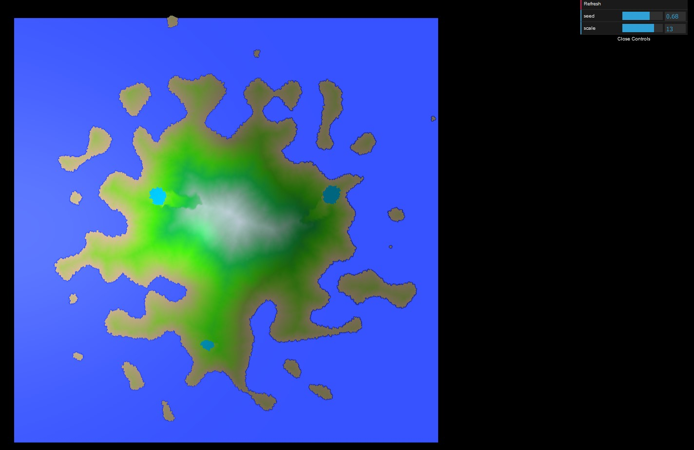

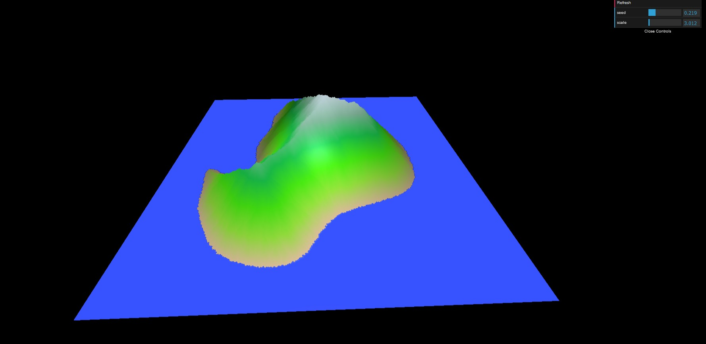

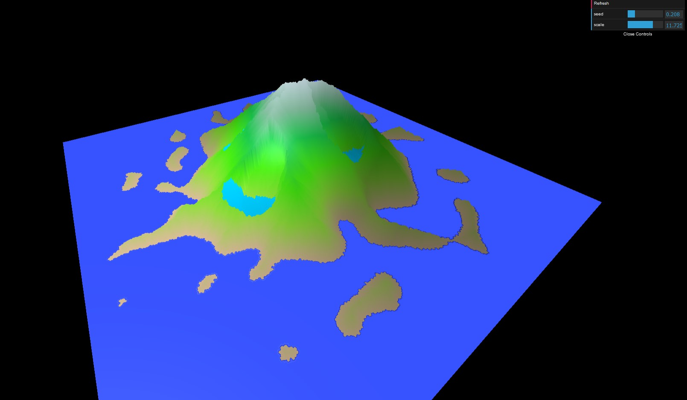

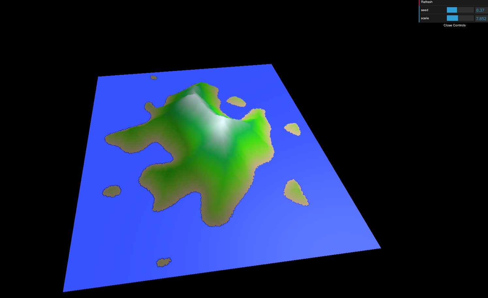

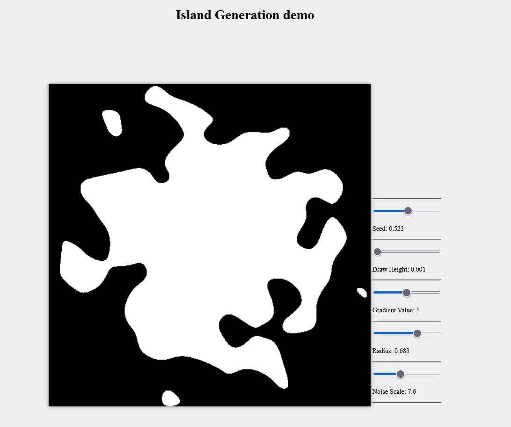

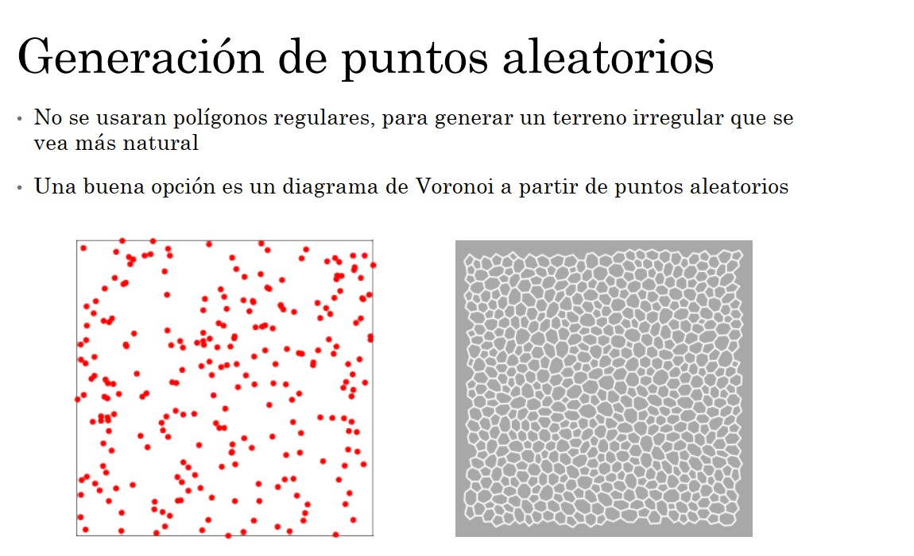

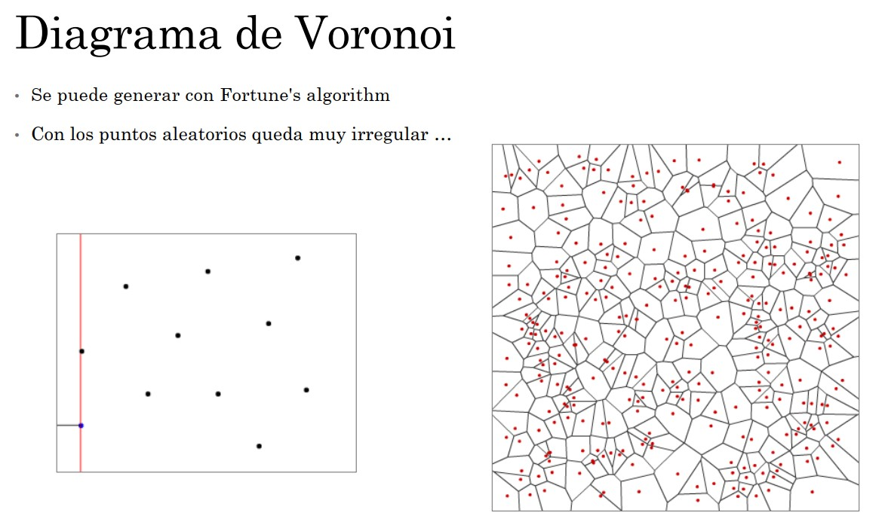

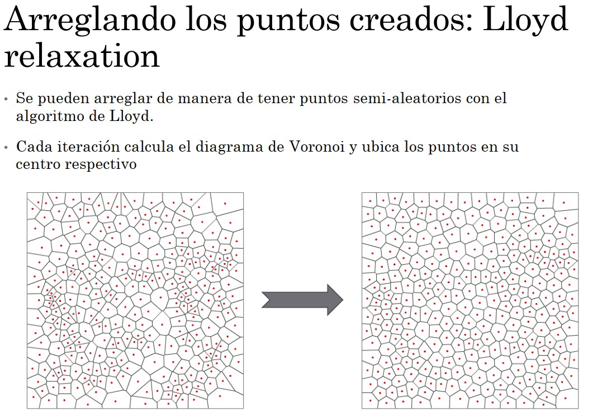

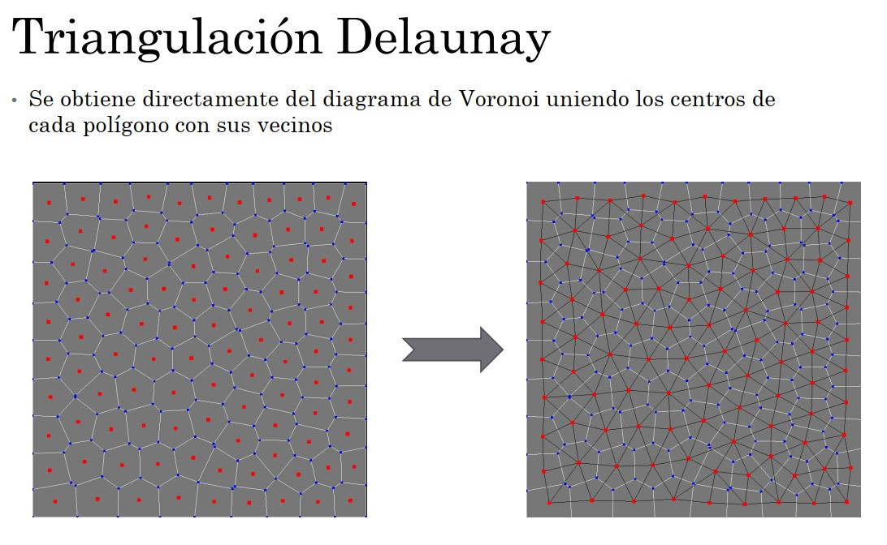

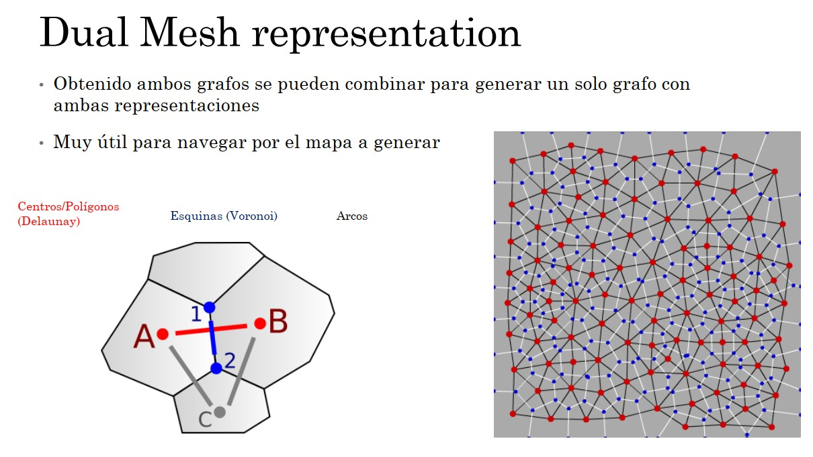

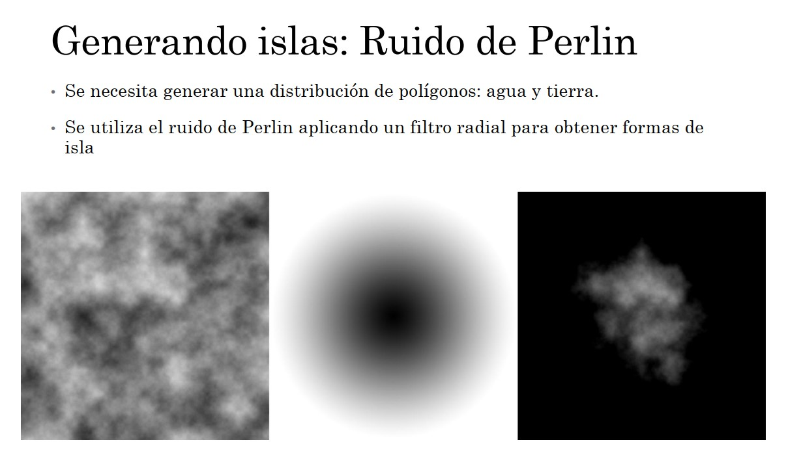

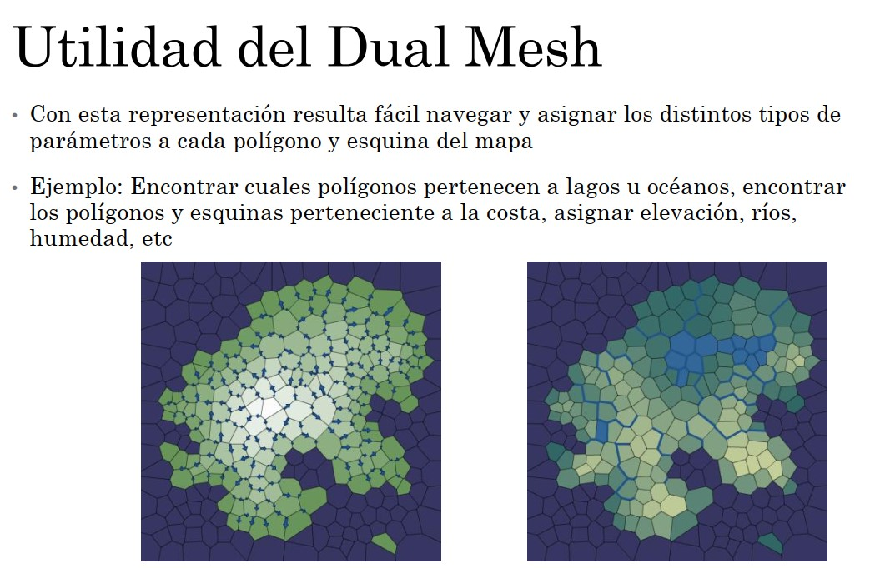
